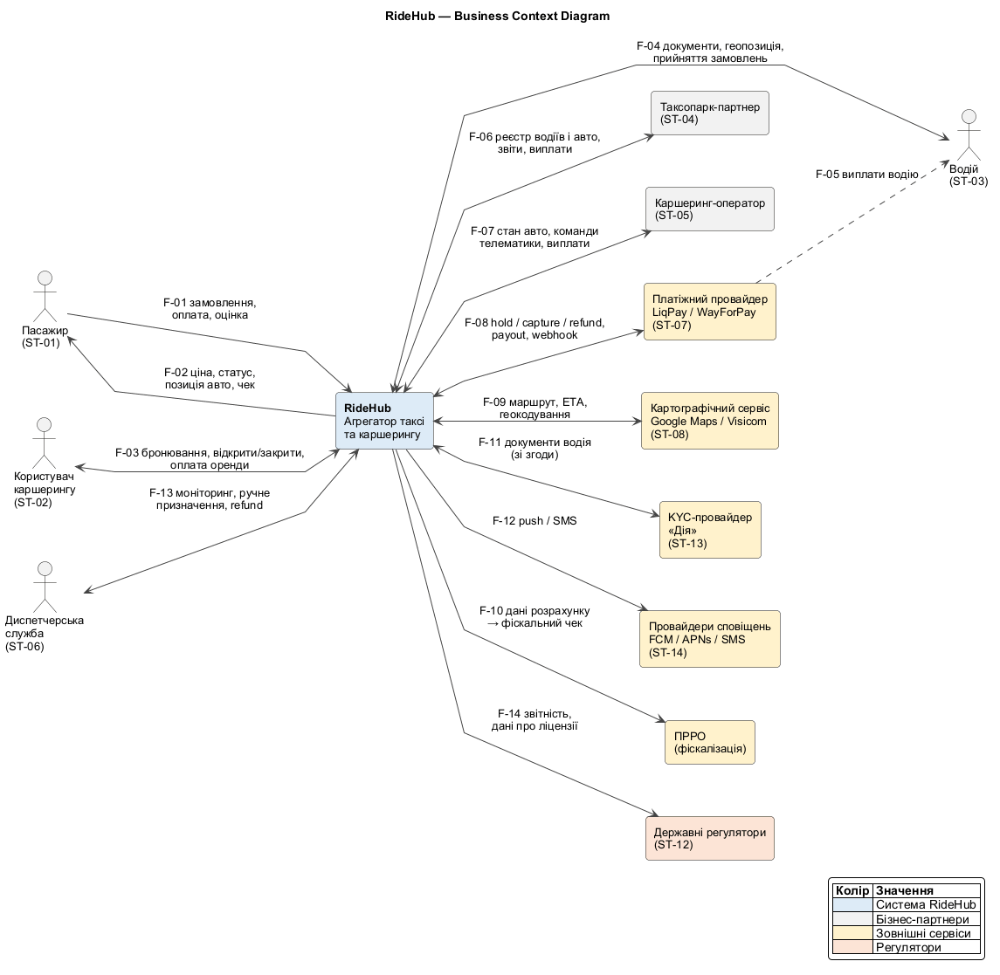

# 1. Предметна область і стейкхолдери

> Технічна вимога №1 · Напрям 1 — стейкхолдери

## 1.1. Опис предметної області

### Що таке RideHub

**RideHub** — агрегатор міської мобільності для міст України (Київ, Львів, Одеса, Дніпро, Харків). В одному мобільному застосунку він поєднує два сервіси:

- **Таксі.** Пасажир замовляє поїздку з точки А в точку Б, а RideHub знаходить найближчого вільного водія одного з партнерів.
- **Каршеринг.** Користувач знаходить вільне авто поруч, бронює його, відкриває зі смартфона і платить за хвилини оренди.

RideHub працює за моделлю **чистого агрегатора**. Власних автомобілів і водіїв у штаті немає. Пропозицію формують партнери:

- **таксопарки**, у яких водії працюють як ФОП або за договором з парком;
- **незалежні водії-ФОП**, які підключаються напряму;
- **каршеринг-оператори**, які володіють автопарком і телематикою.

Дохід RideHub — **комісія** з кожної поїздки чи оренди (відсоток від вартості). Пасажир платить RideHub через платіжного провайдера, а RideHub виплачує партнерам їхню частку за вирахуванням комісії. Якщо поїздку оплачено готівкою, водій отримує всю суму, а комісія списується з його балансу в RideHub.

### Бізнес-цілі

| ID | Бізнес-ціль | Як вимірюємо |
|---|---|---|
| BG-01 | Дати користувачу один застосунок для всіх видів міських поїздок (таксі та каршеринг) | Частка користувачів, які користуються обома сервісами |
| BG-02 | Швидко подавати авто: пасажир чекає на призначення водія не довше пів хвилини | Час від замовлення до призначення водія |
| BG-03 | Підключати нових партнерів (таксопарки, каршеринг-оператори) без переробки системи | Час інтеграції нового партнера |
| BG-04 | Отримувати стабільний дохід із комісії навіть у пікові години | Частка успішно оплачених поїздок, виручка в пікові години |
| BG-05 | Бути безпечним і законним сервісом: перевірені водії, захищені платежі, фіскальні чеки | Кількість інцидентів безпеки, скарг, порушень |

### Межі системи

| Входить у систему RideHub | Не входить (зовнішнє або поза обсягом) |
|---|---|
| Реєстрація та автентифікація пасажирів, водіїв і співробітників партнерів | Обробка даних банківських карток. Цим займається платіжний провайдер, RideHub отримує тільки токен |
| Розрахунок вартості за тарифами, коефіцієнт попиту (surge) | Побудова маршрутів і геокодування (картографічний сервіс) |
| Пошук і призначення водія, відстеження геопозиції в реальному часі | Керування автопарком і технічним обслуговуванням авто (партнери) |
| Життєвий цикл поїздки та оренди | Бортова телематика авто каршерингу (оператор; RideHub лише надсилає команди через його API) |
| Ініціювання платежів, розподіл виручки, баланси водіїв і партнерів | Фіскалізація чеків (зовнішній програмний РРО) |
| Онбординг і перевірка документів водіїв | Видача документів і ліцензій (державні органи) |
| Консоль диспетчера і підтримки, рейтинги, скарги | Страхування авто та пасажирів |

### Чому система складна

Ці фактори стануть джерелом архітектурно значущих вимог (ASR) на кроці 2:

1. **Геолокація в реальному часі.** Тисячі водіїв на лінії надсилають координати кожні 2–4 секунди. На цих даних побудовані пошук водія і відстеження поїздки.
2. **Пікові навантаження.** Попит різко зростає, наприклад увечері в п'ятницю, у дощ, після концерту чи перед комендантською годиною. Пропозиція водіїв при цьому відстає.
3. **Розподілені транзакції.** Пошук водія, підтвердження і оплата проходять через кілька сервісів і зовнішнього платіжного провайдера, тому класична ACID-транзакція тут неможлива.
4. **Багато незалежних партнерів.** У кожного таксопарку і каршеринг-оператора свій API, свої тарифи і своя надійність.
5. **Безпека і регулювання.** Система обробляє персональні дані, геотреки і платежі, тож можливе шахрайство водіїв (фейкові акаунти, підробка GPS). Крім того, діють вимоги PCI DSS і фіскалізації.
6. **Нестабільна інфраструктура.** Відключення електроенергії та зв'язку означають, що мобільні клієнти часто втрачають з'єднання, і система має це витримувати.

### Глосарій

| Термін | Значення |
|---|---|
| Поїздка (Trip) | Одне замовлення таксі від створення до оплати або скасування |
| Оренда (Rental) | Одне користування авто каршерингу від бронювання до завершення |
| Водій на лінії | Водій, який готовий приймати замовлення і надсилає свою геопозицію |
| Матчинг | Підбір і призначення водія на замовлення |
| Surge | Коефіцієнт попиту, який підвищує тариф, коли водіїв бракує |
| Hold | Блокування суми на картці пасажира до завершення поїздки |
| PSP | Payment Service Provider — платіжний провайдер |
| ПРРО | Програмний реєстратор розрахункових операцій для фіскальних чеків |

## 1.2. Стейкхолдери

| ID | Стейкхолдер | Тип | Інтереси | Вплив на систему | Очікування від RideHub |
|---|---|---|---|---|---|
| ST-01 | **Пасажир** | Зовнішній, користувач | Швидко і недорого доїхати, прозора ціна, безпека | Обирає між RideHub і конкурентами; від нього залежить попит | Подача ≤ 5 хв, ціна відома до поїздки, відстеження авто на мапі |
| ST-02 | **Користувач каршерингу** | Зовнішній, користувач | Вільне авто поруч, швидке відкриття, чесна похвилинна оплата | Обирає між RideHub і застосунками операторів | Бронювання і відкриття авто за ≤ 1 хв, коректний розрахунок вартості |
| ST-03 | **Водій** | Зовнішній, постачальник послуги | Стабільний потік замовлень, прозора комісія, швидкі виплати | Формує пропозицію; без водіїв сервісу немає | Замовлення поруч, навігація, баланс і виплати, захист акаунта |
| ST-04 | **Таксопарк-партнер** | Зовнішній, бізнес-партнер | Завантаження автопарку, контроль водіїв, звітність | Підключає або відключає десятки водіїв одночасно | API або кабінет для керування водіями, звіти, вчасні виплати |
| ST-05 | **Каршеринг-оператор** | Зовнішній, бізнес-партнер | Завантаження авто, захист від пошкоджень і шахрайства | Може відкрити або закрити доступ до свого автопарку | Надійна інтеграція з телематикою, перевірені користувачі, розрахунки |
| ST-06 | **Диспетчерська служба / підтримка** | Внутрішній, оператор | Бачити проблемні поїздки і швидко їх вирішувати | Ручне призначення водія, скасування, повернення коштів | Консоль моніторингу в реальному часі, історія поїздки, інструменти втручання |
| ST-07 | **Платіжний провайдер (PSP)** — LiqPay / WayForPay | Зовнішній, постачальник сервісу | Обсяг транзакцій, відсутність шахрайства | Може заблокувати прийом платежів; задає вимоги PCI DSS, 3-D Secure | Коректна інтеграція, ідемпотентні запити, обробка webhook-ів |
| ST-08 | **Картографічний сервіс** — Google Maps Platform / Visicom | Зовнішній, постачальник сервісу | Обсяг платних запитів, дотримання ліцензії | Без нього немає маршрутів, ETA і ціни; змінює тарифи на API | Дотримання квот, кешування в межах ліцензії |
| ST-09 | **Власник продукту / менеджмент RideHub** | Внутрішній, замовник | Ріст, дохід, частка ринку | Визначає пріоритети і бюджет | Швидкий вихід функцій, метрики бізнесу, керовані тарифи |
| ST-10 | **Служба безпеки та антифроду** | Внутрішній | Відсутність шахрайства, захист даних | Може заблокувати реліз або акаунт | Аудит-логи, перевірка водіїв, виявлення підробки GPS, захист платежів |
| ST-11 | **Команда розробки та експлуатації (Dev/SRE)** | Внутрішній | Стабільність, зручність змін і розгортання | Реалізує та підтримує систему | Незалежне розгортання, спостережуваність (observability), автоматизовані перевірки |
| ST-12 | **Державні регулятори** — Укртрансбезпека, ДПС, Уповноважений ВРУ з прав людини (захист персональних даних) | Зовнішній, регулятор | Ліцензовані перевезення, сплата податків, захист персональних даних | Штрафи, приписи, блокування діяльності | Перевірка ліцензій і документів, фіскальні чеки, захист і мінімізація даних |
| ST-13 | **Провайдер перевірки документів (KYC)** — «Дія» (шерінг документів) | Зовнішній, постачальник сервісу | Коректне використання API | Без нього онбординг водіїв і користувачів каршерингу сповільнюється | Інтеграція за правилами провайдера, згода користувача |
| ST-14 | **Провайдери сповіщень** — FCM / APNs, SMS-шлюз | Зовнішній, постачальник сервісу | Обсяг повідомлень | Замінні; при відмові страждає UX, але не ядро | Дотримання лімітів, резервний канал |

## 1.3. Матриця «влада — інтерес»

Оцінка за шкалою 1–5. **Влада** — наскільки стейкхолдер здатен вплинути на систему або заблокувати її. **Інтерес** — наскільки результат роботи системи для нього важливий.

| ID | Стейкхолдер | Влада | Інтерес | Квадрант |
|---|---|---|---|---|
| ST-01 | Пасажир | 4 | 5 | Manage closely |
| ST-02 | Користувач каршерингу | 4 | 5 | Manage closely |
| ST-03 | Водій | 4 | 5 | Manage closely |
| ST-04 | Таксопарк-партнер | 4 | 4 | Manage closely |
| ST-05 | Каршеринг-оператор | 4 | 4 | Manage closely |
| ST-09 | Власник продукту | 5 | 5 | Manage closely |
| ST-07 | Платіжний провайдер | 5 | 3 | Keep satisfied |
| ST-08 | Картографічний сервіс | 4 | 2 | Keep satisfied |
| ST-12 | Державні регулятори | 5 | 2 | Keep satisfied |
| ST-06 | Диспетчерська служба | 2 | 5 | Keep informed |
| ST-10 | Служба безпеки та антифроду | 3 | 4 | Keep informed |
| ST-11 | Команда Dev/SRE | 2 | 4 | Keep informed |
| ST-13 | KYC-провайдер | 2 | 2 | Monitor |
| ST-14 | Провайдери сповіщень | 1 | 2 | Monitor |

Межа між «низьким» і «високим» рівнем — 3. Значення 3 і вище вважаємо високим.

```
            ▲ Влада
            │
   високий  │  KEEP SATISFIED              │  MANAGE CLOSELY
            │  ST-07 Платіжний провайдер   │  ST-01 Пасажир
            │  ST-08 Картографічний сервіс │  ST-02 Користувач каршерингу
            │  ST-12 Регулятори            │  ST-03 Водій
            │                              │  ST-04 Таксопарк-партнер
            │                              │  ST-05 Каршеринг-оператор
            │                              │  ST-09 Власник продукту
            │                              │  ST-10 Безпека та антифрод
            ├──────────────────────────────┼──────────────────────────────
   низький  │  MONITOR                     │  KEEP INFORMED
            │  ST-13 KYC-провайдер         │  ST-06 Диспетчерська служба
            │  ST-14 Провайдери сповіщень  │  ST-11 Команда Dev/SRE
            │                              │
            └──────────────────────────────┴──────────────────────────────► Інтерес
                        низький                        високий
```

> Служба безпеки (влада 3, інтерес 4) формально потрапляє в Manage closely. Вона може заблокувати реліз, тому її залучаємо до рішень про автентифікацію та платежі (STRIDE, крок 9).

### Обґрунтування розміщення

**Manage closely**
- **Пасажир, користувач каршерингу, водій.** Поодинці вони мало що вирішують, але разом це обидві сторони двостороннього ринку. Відтік пасажирів знищує попит, а відтік водіїв знищує пропозицію. Від них походить більшість функціональних вимог і вимог до продуктивності.
- **Таксопарки та каршеринг-оператори.** Один партнер приносить десятки водіїв або авто і може одним рішенням їх забрати. Їм потрібні інтеграції та звітність, тому вони впливають на вимоги до розширюваності.
- **Власник продукту** фінансує проєкт і визначає пріоритети.
- **Служба безпеки** має право вето на реліз і блокування акаунтів.

**Keep satisfied**
- **Платіжний провайдер** диктує технічні умови інтеграції (PCI DSS, 3-D Secure, webhook-и, ідемпотентність) і може припинити прийом платежів. Деталі нашої системи йому не цікаві, доки не порушено його правил.
- **Картографічний сервіс** — критична залежність: без нього немає маршруту і ціни. Його інтерес обмежується квотами і ліцензією.
- **Регулятори** можуть зупинити діяльність, але цікавляться системою лише щодо відповідності законодавству: ліцензії перевізників, фіскалізація, захист персональних даних.

**Keep informed**
- **Диспетчерська служба** щодня працює із системою і дуже залежить від консолі, але на архітектурні рішення не впливає.
- **Команда Dev/SRE** живе з наслідками архітектури, тому її треба інформувати. Вона ж є джерелом вимог до супроводжуваності.

**Monitor**
- **KYC-провайдер і провайдери сповіщень** замінні, а їхній інтерес обмежується обсягом запитів.

## 1.4. Контекстна діаграма (business context)

Джерело: [`diagrams/01-context-business.puml`](../diagrams/01-context-business.puml)



Діаграма показує RideHub як «чорну скриньку» і **бізнес-обміни** із зовнішнім оточенням: замовлення, гроші, документи, дані. Технічні протоколи з'являться на C4-діаграмах (крок 4).

### Потоки

| ID | Від → до | Що передається | Тип обміну |
|---|---|---|---|
| F-01 | Пасажир → RideHub | Замовлення поїздки (адреси, клас авто), оплата, оцінка | Послуга, гроші |
| F-02 | RideHub → Пасажир | Ціна, статус і позиція авто, чек | Інформація |
| F-03 | Користувач каршерингу ↔ RideHub | Бронювання, команди «відкрити / закрити», оплата оренди, рахунок | Послуга, гроші |
| F-04 | Водій ↔ RideHub | Документи, геопозиція, прийняття замовлень / замовлення, навігація, баланс | Послуга, дані |
| F-05 | RideHub → Водій | Виплати (через PSP) за вирахуванням комісії | Гроші |
| F-06 | Таксопарк-партнер ↔ RideHub | Реєстр водіїв і авто / звіти, виплати | Дані, гроші |
| F-07 | Каршеринг-оператор ↔ RideHub | Каталог і стан авто / команди телематики, бронювання, виплати | Дані, гроші |
| F-08 | RideHub ↔ Платіжний провайдер | Запити hold / capture / refund / payout / результати, webhook-и | Гроші |
| F-09 | RideHub ↔ Картографічний сервіс | Адреси, координати / маршрут, ETA, геокодування | Дані |
| F-10 | RideHub → ПРРО | Дані про розрахунок → фіскальний чек | Регуляторний обмін |
| F-11 | RideHub ↔ KYC-провайдер («Дія») | Запит документів / посвідчення водія, ID-дані (зі згоди) | Дані |
| F-12 | RideHub → Провайдери сповіщень | Push і SMS (коди входу, статуси поїздки) | Інформація |
| F-13 | Диспетчерська служба ↔ RideHub | Моніторинг / ручне призначення, скасування, повернення коштів | Операційне керування |
| F-14 | RideHub → Регулятори | Звітність, відповіді на запити, дані про ліцензії перевізників | Регуляторний обмін |
