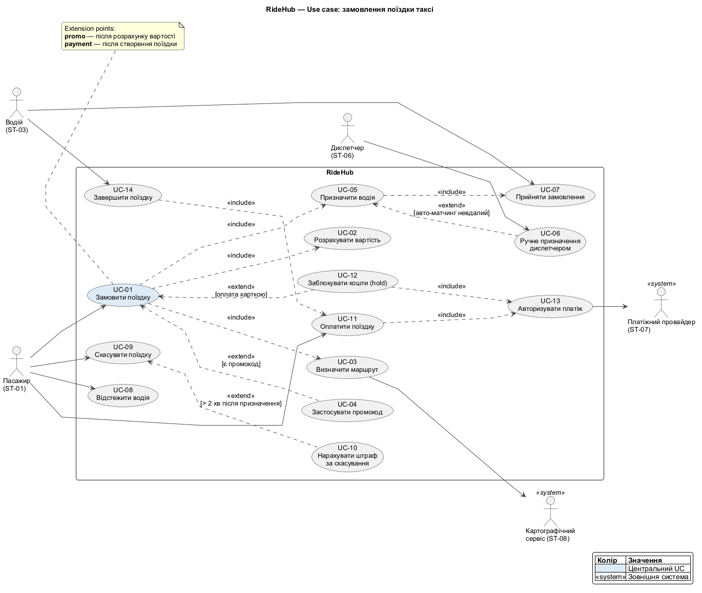
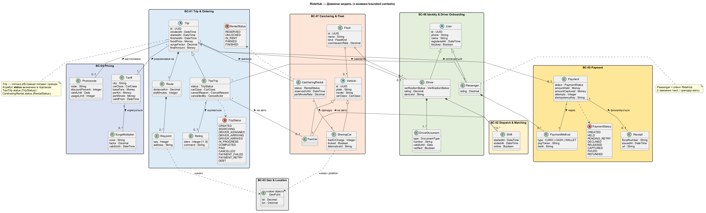
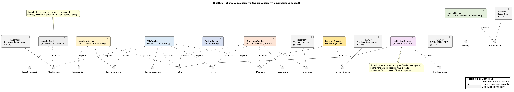

# 3. UML-моделі

> Технічна вимога №3 · Напрям 1 — use-case модель замовлення поїздки, доменна модель, діаграма компонентів

Ключова ідея розділу: три моделі — це три проєкції одного й того самого змісту. Кожен use case спирається на сутності доменної моделі, кожна сутність належить одному bounded context, а кожен bounded context реалізує один компонент. Таблиці в п. 3.5 фіксують цей ланцюжок.

## 3.1. Діаграма варіантів використання

Джерело: [`diagrams/03-usecase.puml`](../diagrams/03-usecase.puml)

### Актори

| Актор | Тип | Стейкхолдер | Участь |
|---|---|---|---|
| Пасажир | Первинний | ST-01 | Замовляє, відстежує, скасовує, оплачує поїздку |
| Водій | Первинний | ST-03 | Приймає замовлення, завершує поїздку |
| Диспетчер | Первинний | ST-06 | Призначає водія вручну, коли автоматичний матчинг не впорався |
| Платіжний провайдер | Вторинний (система) | ST-07 | Авторизує платіж, hold і списання |
| Картографічний сервіс | Вторинний (система) | ST-08 | Будує маршрут і ETA |

### Перелік use case

| ID | Use case | Актор | User stories |
|---|---|---|---|
| UC-01 | Замовити поїздку | Пасажир | US-03 |
| UC-02 | Розрахувати вартість | — (включений) | US-02, US-21 |
| UC-03 | Визначити маршрут | Картографічний сервіс | US-02, US-03 |
| UC-04 | Застосувати промокод | Пасажир (розширення) | US-09 |
| UC-05 | Призначити водія | — (включений) | US-03, US-16 |
| UC-06 | Ручне призначення диспетчером | Диспетчер | US-19 |
| UC-07 | Прийняти замовлення | Водій | US-16 |
| UC-08 | Відстежити водія | Пасажир | US-04, US-15 |
| UC-09 | Скасувати поїздку | Пасажир | US-05 |
| UC-10 | Нарахувати штраф за скасування | — (розширення) | US-05 |
| UC-11 | Оплатити поїздку | Пасажир | US-06 |
| UC-12 | Заблокувати кошти (hold) | — (розширення) | US-06 |
| UC-13 | Авторизувати платіж | Платіжний провайдер | US-06 |
| UC-14 | Завершити поїздку | Водій | US-06, US-17 |

### Відношення include і extend

| Відношення | Базовий UC | Включений / розширюючий UC | Пояснення |
|---|---|---|---|
| include | UC-01 Замовити поїздку | UC-02 Розрахувати вартість | Без ціни замовити не можна, крок обов'язковий |
| include | UC-01 Замовити поїздку | UC-03 Визначити маршрут | Маршрут потрібен для ціни і для водія |
| include | UC-01 Замовити поїздку | UC-05 Призначити водія | Поїздка без призначення водія не має сенсу |
| include | UC-05 Призначити водія | UC-07 Прийняти замовлення | Призначення завершується лише підтвердженням водія |
| include | UC-14 Завершити поїздку | UC-11 Оплатити поїздку | Завершення завжди запускає оплату (для готівки — облік комісії) |
| include | UC-11 Оплатити поїздку | UC-13 Авторизувати платіж | Спільний крок для списання |
| include | UC-12 Заблокувати кошти | UC-13 Авторизувати платіж | Той самий крок, повторно використовується |
| extend | UC-01 Замовити поїздку | UC-04 Застосувати промокод | Лише якщо пасажир ввів промокод (точка розширення **promo**) |
| extend | UC-01 Замовити поїздку | UC-12 Заблокувати кошти (hold) | Лише при оплаті карткою (точка розширення **payment**) |
| extend | UC-05 Призначити водія | UC-06 Ручне призначення диспетчером | Лише коли автоматичний матчинг не знайшов водія |
| extend | UC-09 Скасувати поїздку | UC-10 Нарахувати штраф за скасування | Лише коли минуло понад 2 хв після призначення (US-05) |

Разом **7 include** і **4 extend** (вимога — не менше двох пар кожного виду). Правило, за яким відрізняли: *include* — крок без якого сценарій не може завершитися, *extend* — крок, що виконується лише за умови.

### Специфікація UC-01. Замовити поїздку

| Поле | Зміст |
|---|---|
| Актор | Пасажир; вторинні — Картографічний сервіс, Платіжний провайдер |
| Мета | Пасажир отримує призначеного водія і підтверджену ціну |
| Передумови | Пасажир автентифікований (US-01); є прив'язаний спосіб оплати; увімкнена геолокація або вказана адреса подачі |
| Тригер | Пасажир натискає «Замовити» на екрані з розрахованою ціною |
| Постумови (успіх) | `TaxiTrip.status = DRIVER_ASSIGNED`; при оплаті карткою на картці є hold на `fixedPrice` |
| Постумови (невдача) | `TaxiTrip.status = CANCELLED`, причина `NO_DRIVER_FOUND`; hold знято |
| Сутності | Passenger, TaxiTrip, Route, Waypoint, Tariff, SurgeMultiplier, Promocode, Payment, PaymentMethod |

**Основний потік**

1. Пасажир вказує точки «звідки» і «куди» та клас авто.
2. Система виконує **UC-03** (маршрут і ETA): отримує `Route` і `Waypoint` від картографічного сервісу.
3. Система виконує **UC-02**: за `Tariff` і `SurgeMultiplier` розраховує ціну. Якщо `surgeFactor > 1,0`, показує коефіцієнт явно і просить підтвердити (US-02).
4. *Точка розширення **promo**:* якщо введено промокод, виконується **UC-04**, ціна перераховується.
5. Пасажир обирає спосіб оплати й натискає «Замовити».
6. Система створює `TaxiTrip` зі статусом `CREATED` і фіксує `fixedPrice` та `surgeFactor`.
7. *Точка розширення **payment**:* якщо оплата карткою, виконується **UC-12** (hold), який викликає **UC-13**.
8. Система переводить поїздку в `SEARCHING` і виконує **UC-05**.
9. Після прийняття водієм (`DRIVER_ASSIGNED`) пасажир бачить ім'я водія, авто, номер і час подачі (US-03).

**Альтернативні потоки**

| № | Умова | Дія |
|---|---|---|
| A1 (крок 3) | Ціну розраховано, але минуло 5 хв без замовлення | Ціна перераховується (US-02) |
| A2 (крок 4) | Промокод прострочений або вже використаний | Показано причину, ціна не змінюється (US-09) |
| A3 (крок 7) | PSP відмовив у hold | Пасажиру пропонують інший спосіб оплати; поїздка не переходить у `SEARCHING` |
| A4 (крок 7) | PSP недоступний (таймаут) | За NFR-05 поїздка не блокується: hold відкладається, платіж позначається `PENDING_RETRY` (деталі — крок 6) |
| A5 (крок 8) | За 3 хв водія не знайдено | Пасажиру пропонують підвищити клас, зачекати ще або обрати каршеринг поруч (US-03); якщо відмовився — `CANCELLED` (`NO_DRIVER_FOUND`), hold знімається |
| A6 (будь-коли до `IN_PROGRESS`) | Пасажир скасовує | Виконується **UC-09** |
| A7 (крок 6) | Повторний запит із тим самим `Idempotency-Key` (втрата зв'язку, NFR-16) | Повертається вже створена поїздка, дубль не створюється |

### Специфікація UC-05. Призначити водія

| Поле | Зміст |
|---|---|
| Актор | Водій (через UC-07); за потреби Диспетчер (UC-06) |
| Мета | Знайти і зафіксувати за поїздкою водія, який погодився її виконати |
| Передумови | `TaxiTrip.status = SEARCHING`; у радіусі пошуку є водії з `Shift.online = true` |
| Постумови | `TaxiTrip.status = DRIVER_ASSIGNED`, `TaxiTrip.driver` і `TaxiTrip.car` заповнені |
| Сутності | TaxiTrip, Driver, Shift, TaxiCar, GeoPoint |

**Основний потік**

1. Система запитує вільних водіїв у радіусі 5 км від точки подачі, відсортованих за відстанню і рейтингом.
2. Система надсилає пропозицію першому кандидату (**UC-07**): точка подачі, відстань, ціна, 15 с на рішення.
3. Водій приймає пропозицію.
4. Система фіксує водія й авто за поїздкою, змінює статус на `DRIVER_ASSIGNED`, водій отримує навігацію.

**Альтернативні потоки**

| № | Умова | Дія |
|---|---|---|
| A1 (крок 3) | Водій відхилив або не відповів за 15 с | Пропозиція переходить до наступного кандидата |
| A2 (крок 1) | Вільних водіїв у радіусі немає | Радіус розширюється; якщо за 3 хв водія немає, див. A5 у UC-01 |
| A3 (будь-який) | Автоматичний матчинг не впорався, поїздка «застрягла» (US-18) | Диспетчер виконує **UC-06**: обирає водія вручну, той отримує пропозицію з позначкою «від диспетчера»; дія фіксується в аудит-журналі (NFR-10) |
| A4 (крок 3) | Водій прийняв, але пасажир уже скасував | Пропозиція анулюється, водій повертається в «вільний» |

### Специфікація UC-09. Скасувати поїздку

| Поле | Зміст |
|---|---|
| Актор | Пасажир |
| Мета | Припинити поїздку з мінімальними втратами для всіх сторін |
| Передумови | `TaxiTrip.status ∈ {CREATED, SEARCHING, DRIVER_ASSIGNED, DRIVER_ARRIVING, DRIVER_ARRIVED}` |
| Постумови | `TaxiTrip.status = CANCELLED`, `cancelledBy = PASSENGER`; hold знято або штраф списано; водій вільний |
| Сутності | TaxiTrip, Driver, Payment, Tariff |

**Основний потік**

1. Пасажир натискає «Скасувати».
2. Система визначає, чи безкоштовне скасування: водія ще не призначено або з моменту призначення минуло менше 2 хв.
3. Поїздка переходить у `CANCELLED`, hold на картці знімається (release).
4. Водій отримує сповіщення і стає вільним.

**Альтернативні потоки**

| № | Умова | Дія |
|---|---|---|
| A1 (крок 2) | Минуло понад 2 хв після призначення | *Extend:* виконується **UC-10** — перед підтвердженням показується штраф; після згоди він списується через PSP |
| A2 (крок 3) | PSP недоступний при знятті hold | Release ставиться в чергу на повтор (Retry); поїздка все одно `CANCELLED` (NFR-05) |
| A3 | Поїздка вже `IN_PROGRESS` | Скасування недоступне; пасажир може лише завершити поїздку достроково через водія |

## 3.2. Доменна модель

Джерело: [`diagrams/03-domain-model.puml`](../diagrams/03-domain-model.puml)

Модель містить **22 класи** (сутності та один value object `GeoPoint`) і **2 перелічення** (`TripStatus`, `RentalStatus`): User, Passenger, Driver, DriverDocument, Fleet, Vehicle, TaxiCar, SharingCar, Trip, TaxiTrip, CarsharingRental, Route, Waypoint, Rating, Shift, GeoPoint, Tariff, SurgeMultiplier, Promocode, Payment, PaymentMethod, Receipt. Кожна сутність розкладена на діаграмі по bounded contexts (колір пакета = контекст).

### Узагальнення (generalization)

| Батьківський клас | Нащадки | Що спільне | Чим відрізняються |
|---|---|---|---|
| `User` (abstract) | `Passenger`, `Driver` | Телефон, ім'я, блокування, вхід через OTP (US-01) | Водій має верифікацію, документи, прив'язаний пристрій і зміни; пасажир має способи оплати |
| `Vehicle` (abstract) | `TaxiCar`, `SharingCar` | Номер, модель, клас авто, належність до `Fleet` | `SharingCar` має телематику, заряд, замок; `TaxiCar` прив'язане до водія через `Shift` |
| `Trip` (abstract) | `TaxiTrip`, `CarsharingRental` | Ціна, тариф, час, оплата, пасажир | `TaxiTrip` має водія, маршрут і власний автомат станів; `CarsharingRental` має бронювання і похвилинну тарифікацію |

> Узагальнення `Trip` ← `CarsharingRental` перетинає межу контекстів (BC-01 і BC-07). Це концептуальна модель: у реалізації сервіси не діляться базовим класом, а лише спільним словником (ціна, тариф, час, пасажир).

> Окремий клас `User` потрібен, бо автентифікація (US-01, US-14) однакова для обох ролей. Одна людина може бути і пасажиром, і водієм, тож у реалізації це ролі одного облікового запису.

### Композиція (частина не існує без цілого)

| Ціле | Частина | Кратність | Обґрунтування |
|---|---|---|---|
| `Trip` | `Route` | 1 → 1 | Маршрут створюється для конкретної поїздки; без поїздки не існує |
| `Route` | `Waypoint` | 1 → 2..* | Мінімум точки «звідки» і «куди»; проміжні зупинки додаються |
| `Driver` | `DriverDocument` | 1 → 1..* | Документи видаляються разом із водієм (вимога захисту даних) |
| `Driver` | `Shift` | 1 → 0..* | Зміна має сенс лише для свого водія |
| `Passenger` | `PaymentMethod` | 1 → 0..* | Токен картки належить лише цьому користувачеві |

### Агрегація (частина існує окремо від цілого)

| Агрегат | Частина | Кратність | Обґрунтування |
|---|---|---|---|
| `Fleet` | `Vehicle` | 1 → 0..* | Авто може змінити парк або вийти з нього, не зникаючи з системи |
| `Fleet` | `Driver` | 0..1 → 0..* | Водій-ФОП працює без парку; водій може змінити парк |

`Fleet` описує і таксопарк, і каршеринг-оператора (`kind: FleetKind`). Спільний тип потрібен, бо обидва — партнери з однаковими властивостями: договір, комісія, API-доступ (US-22, ASR-06).

### Асоціації та кратності

| Зв'язок | Кратність | Зміст |
|---|---|---|
| `Trip` — `Passenger` | * — 1 | Пасажир має багато поїздок, поїздка — одного замовника |
| `TaxiTrip` — `Driver` | * — 0..1 | Водія ще немає на статусах `CREATED`, `SEARCHING` |
| `TaxiTrip` — `TaxiCar` | * — 0..1 | Те саме |
| `CarsharingRental` — `SharingCar` | * — 1 | Оренда завжди прив'язана до авто |
| `Trip` — `Payment` | 1 — 0..1 | Платіж з'являється разом із hold або після завершення, тому в нього не завжди є; повторні спроби — це `Payment.attempts`, а не окремі платежі |
| `Trip` — `Tariff` | * — 1 | Один тариф діє для багатьох поїздок; ціна фіксується в `Trip.fixedPrice` |
| `Trip` — `Promocode` | * — 0..1 | Промокод необов'язковий (UC-04) |
| `Payment` — `PaymentMethod` | * — 1 | Один спосіб оплати для багатьох платежів |
| `Payment` — `Receipt` | 1 — 0..1 | Чек виникає лише після успішного списання (US-08) |
| `TaxiTrip` — `Rating` | 1 — 0..1 | Оцінка залишається після поїздки (US-07) |
| `Tariff` — `SurgeMultiplier` | 1 — 0..* | Коефіцієнти діють у зонах і часових вікнах |
| `Shift` — `TaxiCar` | * — 1 | Зміна відбувається на конкретному авто |

Відхилення від плану: зв'язки «водій» і «авто» винесені на `TaxiTrip`, а не на `Trip`, бо в каршерингу водія немає. Так модель не містить обов'язково порожнього зв'язку.

### Статуси

- `TaxiTrip.status: TripStatus` — 12 значень: `CREATED`, `SEARCHING`, `DRIVER_ASSIGNED`, `DRIVER_ARRIVING`, `DRIVER_ARRIVED`, `IN_PROGRESS`, `COMPLETED`, `PAID`, `CANCELLED`, `PAYMENT_FAILED`, `PAYMENT_RETRY`, `DEBT`.
- `CarsharingRental.status: RentalStatus` — 5 значень: `RESERVED`, `UNLOCKED`, `IN_RENT`, `PARKED`, `FINISHED`.

Це **єдиний словник станів** для всіх наступних розділів: діаграма станів (крок 5), Saga (крок 6) і fallback Circuit Breaker. Назви в них мають збігатися літера в літеру.

## 3.3. Bounded contexts

Межі проведено за принципом: різна мова, різні причини змін, різне масштабування. Це безпосередньо випливає з ASR.

| ID | Bounded context | Відповідальність | Ключові сутності | Чому окремий контекст (ASR) |
|---|---|---|---|---|
| BC-01 | Trip & Ordering | Життєвий цикл поїздки, оркестрація Saga, скасування, оцінка | `Trip`, `TaxiTrip`, `Route`, `Waypoint`, `Rating`, `TripStatus` | Центр сценарію «замовлення → оплата» (ASR-04) |
| BC-02 | Dispatch & Matching | Підбір водія, зміни водіїв, ручне призначення | `Shift` (+ індекс доступних водіїв) | Масштабується окремо в пік (ASR-02); залежить від геоданих (ASR-01) |
| BC-03 | Geo & Location | Приймання потоку геопозицій, геоіндекс, push позицій на мапу | `GeoPoint` (value object) | Найвищий потік подій, власне сховище в пам'яті (ASR-01) |
| BC-04 | Pricing | Тарифи, surge, промокоди, розрахунок ціни | `Tariff`, `SurgeMultiplier`, `Promocode` | Тарифи змінюються без релізу (NFR-12, US-21) |
| BC-05 | Payment | Hold, capture, refund, виплати, баланси, чеки, звірка з PSP | `Payment`, `PaymentMethod`, `Receipt` | PCI DSS-межа і ізоляція відмов PSP (ASR-03, ASR-05) |
| BC-06 | Identity & Driver Onboarding | Автентифікація, MFA, прив'язка пристрою, перевірка документів | `User`, `Passenger`, `Driver`, `DriverDocument` | Безпекова межа довіри (ASR-05) |
| BC-07 | Carsharing & Fleet | Реєстр партнерів і авто, бронювання, оренда, адаптери телематики | `Fleet`, `Vehicle`, `TaxiCar`, `SharingCar`, `CarsharingRental`, `RentalStatus` | Антикорупційний шар до API партнерів (ASR-06) |
| BC-08 | Notification | Push і SMS, шаблони, повтори, резервний канал | — (подієві шаблони) | Некритичний для ядра; замінні провайдери (NFR-05) |

Між контекстами сутності посилаються одна на одну лише за ідентифікатором (наприклад, `TaxiTrip.driverId`), а не за прямим посиланням на об'єкт. Це вимога, яка не дозволить зробити спільну БД (Distributed Monolith, крок 8).

## 3.4. Діаграма компонентів

Джерело: [`diagrams/03-components.puml`](../diagrams/03-components.puml)

Один компонент = один bounded context, тобто 8 внутрішніх компонентів і 5 зовнішніх.

### Інтерфейси

| Компонент | Контекст | Provides | Requires |
|---|---|---|---|
| TripService | BC-01 | `ITripManagement` | `IPricing`, `IDriverMatching`, `IPayment`, `INotify`, `IMapProvider` |
| MatchingService | BC-02 | `IDriverMatching` | `ILocationQuery`, `INotify` |
| LocationService | BC-03 | `ILocationQuery`, `ILocationIngest` | `IMapProvider` |
| PricingService | BC-04 | `IPricing` | — |
| PaymentService | BC-05 | `IPayment` | `IPaymentGateway` |
| IdentityService | BC-06 | `IIdentity` | `IKycProvider` |
| CarsharingService | BC-07 | `ICarsharing` | `IPricing`, `IPayment`, `INotify`, `ITelematics` |
| NotificationService | BC-08 | `INotify` | `IPushGateway` |

Зовнішні компоненти: Картографічний сервіс (`IMapProvider`, ST-08), PSP (`IPaymentGateway`, ST-07), KYC «Дія» (`IKycProvider`, ST-13), телематика авто (`ITelematics`, ST-05), FCM / APNs / SMS (`IPushGateway`, ST-14).

### Ключові операції інтерфейсів

| Інтерфейс | Операції (спрощено) | Використовується в |
|---|---|---|
| `ITripManagement` | `createTrip`, `getTrip`, `cancelTrip`, `completeTrip` | UC-01, UC-08, UC-09, UC-14 |
| `IPricing` | `quote(route, carClass, promocode)`, `rentalCost(minutes)` | UC-02, UC-04 |
| `IDriverMatching` | `findAndAssign(tripId)`, `manualAssign(tripId, driverId)` | UC-05, UC-06, UC-07 |
| `ILocationQuery` | `nearbyDrivers(point, radius)`, `driverPosition(driverId)` | UC-05, UC-08 |
| `ILocationIngest` | `publishPosition(driverId, point, ts)` | UC-08 |
| `IPayment` | `hold`, `capture`, `release`, `refund`, `chargePenalty` | UC-10, UC-11, UC-12, UC-13 |
| `INotify` | `push(userId, template, data)`, `sms(phone, text)` | UC-01, UC-05, UC-09 |

### Узгодження з доменною моделлю

Залежності на діаграмі відповідають зв'язкам сутностей: `TaxiTrip` посилається на `Tariff`, `Payment`, `Driver`, а отже, TripService потребує IPricing, IPayment, IDriverMatching. Сам `Driver` у TripService не зберігається, лише його `driverId`.

Залежності на `INotify` показані як синхронні лише на логічному рівні. На C4-діаграмі (крок 4) вони реалізуються подіями в Kafka, на які підписується NotificationService (патерн Observer, крок 8). Так TripService не залежить від доступності сповіщень (NFR-05).

## 3.5. Узгодженість моделей

### UC → сутності → bounded context → компонент

| UC | Ключові сутності | Bounded context | Компонент |
|---|---|---|---|
| UC-01 Замовити поїздку | `TaxiTrip`, `Route`, `Passenger` | BC-01 | TripService |
| UC-02 Розрахувати вартість | `Tariff`, `SurgeMultiplier` | BC-04 | PricingService |
| UC-03 Визначити маршрут | `Route`, `Waypoint`, `GeoPoint` | BC-01 / зовн. | TripService + Картографічний сервіс |
| UC-04 Застосувати промокод | `Promocode` | BC-04 | PricingService |
| UC-05 Призначити водія | `Driver`, `Shift`, `TaxiCar`, `GeoPoint` | BC-02 | MatchingService (+ LocationService) |
| UC-06 Ручне призначення | `Driver`, `Shift`, `TaxiTrip` | BC-02 | MatchingService |
| UC-07 Прийняти замовлення | `Driver`, `TaxiTrip` | BC-02 / BC-01 | MatchingService, TripService |
| UC-08 Відстежити водія | `GeoPoint`, `Driver` | BC-03 | LocationService |
| UC-09 Скасувати поїздку | `TaxiTrip`, `Payment` | BC-01 | TripService |
| UC-10 Штраф за скасування | `Payment`, `Tariff` | BC-05 | PaymentService |
| UC-11 Оплатити поїздку | `Payment`, `PaymentMethod`, `Receipt` | BC-05 | PaymentService |
| UC-12 Hold коштів | `Payment`, `PaymentMethod` | BC-05 | PaymentService |
| UC-13 Авторизувати платіж | `Payment` | BC-05 | PaymentService + PSP |
| UC-14 Завершити поїздку | `TaxiTrip`, `Payment` | BC-01 | TripService |

Кожен UC має компонент, кожна сутність доменної моделі належить одному контексту, кожен контекст має один компонент. Сутності, які не мають жодного UC на цій діаграмі (`DriverDocument`, `Fleet`, `Vehicle`, `SharingCar`, `CarsharingRental`), покриваються UC онбордингу і каршерингу (US-10…US-14, US-22), що виходять за межі use case замовлення таксі і розглядаються в наступних кроках.

### US → UC → компонент (для матриці трасування)

Зведено в [traceability-matrix.md](traceability-matrix.md).
