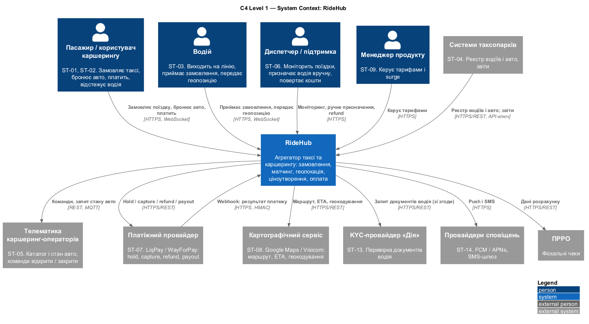
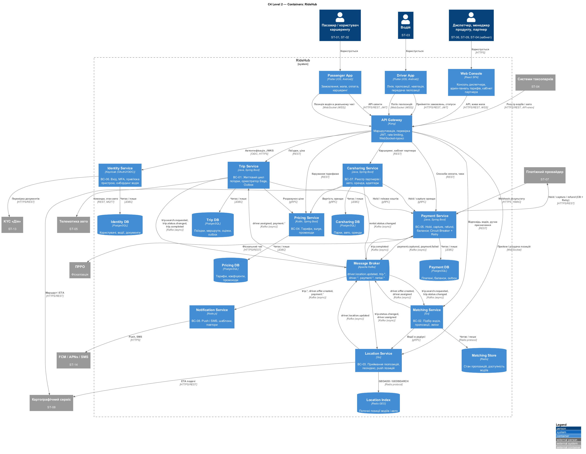

# 4. Архітектурний стиль і C4-модель

> Технічна вимога №4 · Напрям 2 — вибір стилю з урахуванням геолокації в реальному часі та пікових навантажень, C4-модель

## 4.1. Порівняння стилів

### Розглянуті варіанти

| Стиль | Суть у контексті RideHub |
|---|---|
| **Моноліт** | Один розгортуваний застосунок, одна БД; модулі в одному процесі |
| **Модульний моноліт** | Один процес, але жорсткі межі модулів за bounded contexts (з кроку 3), окремі схеми БД; проміжний варіант |
| **SOA** | Кілька великих сервісів навколо корпоративної шини (ESB), спільні схеми, центральна оркестрація |
| **Мікросервіси + event-driven** | Сервіс на bounded context, database-per-service, подієвий брокер, легкі протоколи |

### Критерії і ваги

Рядки таблиці — шість ASR із кроку 2. Додано два критерії, без яких порівняння було б нечесним: **модифікованість** (NFR-12, у кроці 2 її відхилено як ASR, бо вона є наслідком ASR-02 і ASR-06, але вирішено врахувати тут) та **операційна складність**, де мікросервіси за визначенням програють. Ваги відображають бізнес-цінність і архітектурний вплив з utility tree: геолокація і пікові навантаження — головна причина складності системи (розділ 1.1).

Оцінка 1–5: 5 — стиль виконує вимогу природно, 1 — суперечить їй.

| Критерій | Вага | Моноліт | Модульний моноліт | SOA | Мікросервіси |
|---|---|---|---|---|---|
| ASR-01 Геолокація в реальному часі | 20 | **2** | **3** | **3** | **5** |
| ASR-02 Пікові навантаження | 20 | **2** | **2** | **3** | **5** |
| ASR-03 Доступність і ізоляція відмов | 15 | **2** | **2** | **3** | **4** |
| ASR-04 Узгодженість «замовлення → оплата» | 10 | **5** | **5** | **3** | **2** |
| ASR-05 Безпека водія і платежів | 10 | **3** | **3** | **4** | **4** |
| ASR-06 Розширюваність партнерами | 10 | **2** | **3** | **4** | **5** |
| NFR-12 Модифікованість, незалежне розгортання | 5 | **1** | **3** | **3** | **5** |
| Операційна складність і розмір команди | 10 | **5** | **4** | **2** | **1** |
| **Зважений підсумок (з 5)** | 100 | **2,65** | **2,95** | **3,10** | **4,05** |

Підсумок = Σ(вага × оцінка) / 100.

### Пояснення оцінок

**ASR-01 Геолокація (≈ 8 300 оновлень/с у пік)**
- *Моноліт (2).* Потік у кілька тисяч записів за секунду ділить процес і БД із транзакційним навантаженням. Окремий геоіндекс у пам'яті можна додати, але масштабувати його окремо від решти не вийде.
- *Модульний моноліт (3).* Модуль Location має власне сховище (Redis), тому БД не навантажується. Проте масштабується весь процес разом, а WebSocket-з'єднання тримає той самий вузол, що й бізнес-логіка.
- *SOA (3).* Окремий сервіс геолокації можливий, але шина (ESB) з її маршрутизацією і трансформаціями додає затримку й стає вузьким місцем для високочастотного потоку.
- *Мікросервіси (5).* Location Service з Redis GEO, прямим WebSocket і Kafka шардується за містом і масштабується незалежно. Затримку ≤ 2 с (NFR-01) забезпечує відсутність зайвих проміжних ланок.

**ASR-02 Пікові навантаження (10×)**
- *Моноліт (2) і модульний моноліт (2).* Масштабується лише ціле. У пік навантажені матчинг, ціна і геолокація, а онбординг і звітність простоюють, але все одно дублюються в кожному екземплярі. Автомасштабування за 3 хв дороге й повільне (великий образ, прогрів кешів).
- *SOA (3).* Сервіси масштабуються окремо, але через шину, яка сама стає спільним ресурсом.
- *Мікросервіси (5).* Масштабується точково тільки Matching, Location і Pricing (stateless, Go/Kotlin, швидкий старт). Kafka згладжує сплески як буфер.

**ASR-03 Доступність і ізоляція відмов**
- *Моноліт (2) і модульний моноліт (2).* Витік пам'яті або зависання пулу потоків через PSP зупиняє всі сценарії. У монолітній моделі складно задати окремі bulkhead-и для зовнішніх викликів.
- *SOA (3).* Відмова частково локалізується в сервісі, але ESB — єдина точка відмови.
- *Мікросервіси (4).* Збій Notification, Payment чи Carsharing не зупиняє Trip, а Circuit Breaker і Retry навколо PSP ізолюють зовнішню залежність. Не 5, бо ланцюжки синхронних викликів між сервісами знову множать доступності, тому синхронні виклики на критичному шляху обмежено (Pricing, Maps, Payment-hold).

**ASR-04 Узгодженість «замовлення → оплата»**
- *Моноліт (5) і модульний моноліт (5).* Одна ACID-транзакція в одній БД. Єдина вимога, де розподілена архітектура гірша.
- *SOA (3).* Сервіси мають власні сховища, але оркестрація через ESB (BPEL) зазвичай дає складніше керування компенсаціями.
- *Мікросервіси (2).* Немає розподіленої ACID-транзакції, потрібні Saga, Outbox, ідемпотентність і eventual consistency. Це свідома ціна, її пом'якшення описано в 4.2.

**ASR-05 Безпека**
- *Моноліт (3), модульний моноліт (3).* Одна межа довіри: компрометація будь-якого модуля дає доступ до всього, включно з платежами. Область PCI DSS охоплює весь застосунок.
- *SOA (4), мікросервіси (4).* Платіжний і identity-контури виділено окремо, область PCI DSS мінімальна. Мікросервіси не отримують 5, бо збільшується поверхня атаки (більше мережевих меж, секретів, mTLS), тому STRIDE на кроці 9 важливий.

**ASR-06 Розширюваність партнерами**
- *Моноліт (2).* Кожна інтеграція змінює спільний код, ризик регресій у ядрі.
- *Модульний моноліт (3).* Є межі модулів, але випуск залишається спільним.
- *SOA (4).* Адаптери можливі, зв'язування через ESB-контракти.
- *Мікросервіси (5).* Адаптер партнера — окремий компонент усередині Carsharing Service (або окремий сервіс), стабільні внутрішні контракти, незалежне розгортання. Вимога «0 змін у ядрі» (NFR-11) виконується природно.

**NFR-12 Модифікованість**
- Моноліт (1): один реліз для всіх змін. Модульний (3): межі є, випуск спільний. SOA (3): сервіси розгортаються окремо, але контракти шини рухаються повільно. Мікросервіси (5): незалежне розгортання і своя швидкість змін.

**Операційна складність (команда з двох осіб на навчальному проєкті, ≈ 12 контейнерів у проді)**
- Моноліт (5): один артефакт. Модульний (4): один артефакт, трохи дисципліни. SOA (2): ESB потребує спеціалістів. Мікросервіси (1): Kubernetes, спостережуваність, CI/CD на кожен сервіс, керування схемами подій.

### Чутливість висновку

Мікросервіси перемагають із запасом (4,05 проти 3,10 у SOA і 2,95 у модульного моноліту). Перевірка на стійкість: якщо вагу операційної складності підняти з 10 до 30, зменшивши ваги ASR-01 і ASR-02 до 10 кожна, результат стає таким: мікросервіси 3,25, модульний моноліт 3,25, моноліт 3,25, SOA 2,90. Тобто перевага мікросервісів **повністю залежить від того, що геолокація і пікові навантаження (ASR-01, ASR-02) визнано визначальними**. Саме це допущення і є суттю рішення. Якби трафік був малим (одне місто, одна команда), обирати слід було б модульний моноліт.

## 4.2. Обґрунтування вибору

**Рішення: мікросервіси з подієво-орієнтованою взаємодією (event-driven)**, що фіксується в **ADR-001** (крок 7).

**Чому саме так**
1. **ASR-01 + ASR-02.** Потік геопозицій і сплески замовлень мають різні профілі навантаження. Тільки незалежне масштабування Location, Matching і Pricing дозволяє витримати пік без переплати за решту системи.
2. **ASR-03.** Ізоляція відмов: PSP, карти або сповіщення не повинні зупиняти поїздки.
3. **ASR-06.** Нові партнери підключаються адаптером, не чіпаючи ядро.
4. **Подієвий стиль** (Kafka) виправданий там, де потрібне слабке зв'язування і буфер: геопотік, статуси поїздки, результати платежів. Де користувач чекає відповідь (ціна, маршрут, hold), залишаємо синхронні gRPC/REST.

**Чесні недоліки і як їх пом'якшуємо**

| Недолік | Наслідок | Пом'якшення |
|---|---|---|
| Операційна складність | Багато контейнерів, мереж, секретів | Kubernetes + єдиний CI/CD-шаблон; observability (trace-id наскрізь, NFR-13); починаємо з 8 сервісів, не дробимо далі |
| Eventual consistency (ASR-04) | Стани поїздки і платежу розходяться на секунди | Оркестраційна Saga з компенсаціями, Transactional Outbox, ідемпотентні ключі, щоденна звірка з PSP (ADR-002) |
| Мережеві відмови між сервісами | Каскадні збої | Таймаути, Circuit Breaker, Retry з jitter, bulkhead; мінімум синхронних викликів на критичному шляху |
| Ризик Distributed Monolith | Сервіси зв'язані ланцюжками викликів і спільною БД | Database-per-service; посилання між контекстами лише за ID; fitness function FF-3 (крок 9) |
| Складність налагодження | Один запит проходить кілька сервісів | Distributed tracing, кореляційний `Idempotency-Key` / trace-id |
| Складність для малої команди | Двоє студентів | Мінімізуємо кількість технологій (Java/Kotlin + Go + Node), стандартні шаблони, не розробляємо власні платформні компоненти |

**Розглянута альтернатива: модульний моноліт.** Це розумний старт для нового продукту: межі модулів ті самі (BC-01…BC-08), а міграція на сервіси пізніше можлива. Ми його не обираємо, бо ASR-01 і ASR-02 з самого початку вимагають незалежного масштабування Location і Matching. Проте межі контекстів (крок 3) спроєктовано так, що кожен можна виділити як модуль.

## 4.3. C4 Level 1 — System Context

Джерело: [`diagrams/04-c4-context.puml`](../diagrams/04-c4-context.puml)

Діаграма повторює склад учасників з бізнес-контексту ([розділ 1.4](01-domain-stakeholders.md)), але з технічними протоколами. Відмінності: пасажир і користувач каршерингу об'єднані в один тип користувача (спільний застосунок), менеджер продукту винесений в окрему особу, а регулятори не показані, бо їхній обмін є звітністю поза програмним контуром.

| Зовнішній учасник | Стейкхолдер | Потік | Протокол |
|---|---|---|---|
| Пасажир, користувач каршерингу | ST-01, ST-02 | F-01…F-03 | HTTPS, WebSocket |
| Водій | ST-03 | F-04 | HTTPS, WebSocket |
| Диспетчер, менеджер продукту | ST-06, ST-09 | F-13 | HTTPS |
| Системи таксопарків | ST-04 | F-06 | HTTPS/REST, API-ключ |
| Телематика авто | ST-05 | F-07 | REST, MQTT |
| Платіжний провайдер | ST-07 | F-08 | HTTPS/REST, webhook (HMAC) |
| Картографічний сервіс | ST-08 | F-09 | HTTPS/REST |
| KYC «Дія» | ST-13 | F-11 | HTTPS/REST |
| Провайдери сповіщень | ST-14 | F-12 | HTTPS |
| ПРРО | — | F-10 | HTTPS/REST |

## 4.4. C4 Level 2 — Container

Джерело: [`diagrams/04-c4-container.puml`](../diagrams/04-c4-container.puml)

### Контейнери

| ID | Контейнер | BC | Компонент (крок 3) | Технологія | Сховище | ASR |
|---|---|---|---|---|---|---|
| CT-01 | Passenger App | — | клієнт | Flutter (iOS 15+, Android 9+) | — | NFR-14, NFR-15, NFR-16 |
| CT-02 | Driver App | — | клієнт | Flutter | — | ASR-01, ASR-05 |
| CT-03 | Web Console | — | клієнт | React SPA | — | US-18, US-19, US-21, US-22 |
| CT-04 | API Gateway | — | інфраструктура | Kong | — | ASR-02, ASR-05 |
| CT-05 | Identity Service | BC-06 | IdentityService | Keycloak, OAuth2/OIDC | PostgreSQL | ASR-05 |
| CT-06 | Trip Service | BC-01 | TripService | Java, Spring Boot | PostgreSQL | ASR-03, ASR-04 |
| CT-07 | Matching Service | BC-02 | MatchingService | Go | Redis | ASR-01, ASR-02 |
| CT-08 | Location Service | BC-03 | LocationService | Go | Redis GEO | ASR-01, ASR-02 |
| CT-09 | Pricing Service | BC-04 | PricingService | Kotlin, Spring Boot | PostgreSQL | ASR-02, NFR-12 |
| CT-10 | Payment Service | BC-05 | PaymentService | Java, Spring Boot | PostgreSQL | ASR-03, ASR-04, ASR-05 |
| CT-11 | Carsharing Service | BC-07 | CarsharingService | Java, Spring Boot | PostgreSQL | ASR-06 |
| CT-12 | Notification Service | BC-08 | NotificationService | Node.js | — | ASR-03 |
| CT-13 | Message Broker | — | інфраструктура | Apache Kafka | Журнал подій | ASR-01, ASR-02, ASR-04 |

Кожен бізнес-сервіс має власне сховище (database-per-service); жоден сервіс не звертається до чужої БД. Це перевіряє FF-3 (крок 9).

Відхилення від прикладу в плані: **Matching** тримає в Redis лише стан пропозицій і доступність водіїв, а геоіндекс належить **Location** (BC-03) і доступний Matching через gRPC `ILocationQuery`. Так збігається з діаграмою компонентів (`MatchingService` requires `ILocationQuery`).

### Відповідність компонентів і контейнерів

Кожен із 8 компонентів кроку 3 став одним контейнером, а їхні інтерфейси реалізовані такими протоколами:

| Інтерфейс | Реалізація на C4 |
|---|---|
| `ITripManagement` | REST через Gateway |
| `IPricing` | gRPC (Trip → Pricing, Carsharing → Pricing) |
| `IPayment` | gRPC для hold / release; Kafka `trip.completed` для capture |
| `IDriverMatching` | Kafka: `trip.search.requested` → `driver.assigned`; REST для відповіді водія і ручного призначення |
| `ILocationQuery` | gRPC (Matching → Location) |
| `ILocationIngest` | WebSocket (Driver App → Gateway → Location) |
| `INotify` | Kafka-події, які споживає Notification (Observer) |
| `IMapProvider`, `IPaymentGateway`, `IKycProvider`, `ITelematics`, `IPushGateway` | HTTPS/REST (телематика: REST або MQTT) |

### Зв'язки та протоколи

| Від → до | Що передається | Протокол | Синх. / асинх. | Чому так |
|---|---|---|---|---|
| Passenger App, Driver App, Web Console → API Gateway | API-запити | HTTPS/REST, JWT | синх. | Користувач чекає відповідь |
| Passenger App ← Location (через Gateway) | Позиція водія | WebSocket | push | Замість опитування: затримка ≤ 2 с (ASR-01) |
| Driver App → Location (через Gateway) | Геопозиції раз на 3 с | WebSocket | потік | Висока частота, допускає втрату точок |
| Системи таксопарків → Gateway | Реєстр водіїв і авто | HTTPS/REST, API-ключ | синх. | Партнерський API (ASR-06) |
| Gateway → Identity | Перевірка токена, JWKS | OIDC/HTTPS | синх. | Централізована автентифікація |
| Gateway → Trip, Matching, Payment, Pricing, Carsharing | Бізнес-запити | REST | синх. | — |
| Gateway → Location | Проксі WebSocket | WebSocket | потік | — |
| Trip → Pricing | Розрахунок ціни | gRPC | синх. | Критичний шлях, низька затримка |
| Trip → Payment | Hold / release | gRPC | синх. | Потрібен результат перед пошуком водія |
| Trip → Картографічний сервіс | Маршрут, ETA | HTTPS/REST | синх. | Потрібно негайно для ціни |
| Matching → Location | Водії в радіусі | gRPC | синх. | Запит до геоіндексу |
| Location → Картографічний сервіс | ETA подачі | HTTPS/REST | синх. | — |
| Carsharing → Pricing, Payment | Вартість оренди, hold | gRPC | синх. | — |
| Payment → PSP | Hold / capture / refund | HTTPS/REST + CB + Retry | синх. | Результат потрібен для наступного кроку |
| PSP → Payment | Webhook результату | HTTPS, HMAC | асинх. | Підтвердження списання приходить пізніше |
| Payment → ПРРО | Фіскальний чек | HTTPS/REST | асинх. (повтор) | ПРРО може бути недоступний (US-08) |
| Identity → KYC | Перевірка документів | HTTPS/REST | синх. | Результат потрібен для онбордингу |
| Carsharing → Телематика | Команди, стан авто | REST, MQTT | синх. / потік | Команди — запит-відповідь, стан — потік |
| Notification → FCM / APNs / SMS | Push, SMS | HTTPS | асинх. | Замінні провайдери, повтори |
| Trip, Matching, Location, Payment, Carsharing → Kafka | Події | Kafka | асинх. | Слабке зв'язування, буфер для пікових сплесків |
| Kafka → Matching, Trip, Payment, Notification, Location | Підписки на події | Kafka | асинх. | — |
| Сервіс → власна БД | Дані | JDBC / Redis | синх. | Database-per-service |

### Основні топіки Kafka

| Топік | Виробник | Споживачі |
|---|---|---|
| `driver.location.updated` | Location | аналітика, діагностика треків (споживачі додаються без змін у виробнику) |
| `trip.search.requested` | Trip | Matching |
| `driver.offer.created` | Matching | Notification |
| `driver.assigned` | Matching | Trip, Location, Notification |
| `trip.status.changed` | Trip | Notification, Location |
| `trip.completed` | Trip | Payment, Notification |
| `payment.captured`, `payment.failed` | Payment | Trip, Notification |
| `rental.status.changed` | Carsharing | Notification |

### Що не показано

Аналітика, звітність для регуляторів і спостережуваність (логи, метрики, трейси) — наскрізні платформні частини. Вони не змінюють межі основних контейнерів, тому на діаграму не винесені.

### Узгодженість

- Усі 8 компонентів кроку 3 мають по одному контейнеру; клієнтські застосунки, Gateway і брокер — додаткові.
- Усі інтеграції з зовнішніми системами, що розглядаються в кроці 6, є стрілками на діаграмі: Trip → Maps (sync REST), Trip → Pricing (sync gRPC), Payment → PSP (sync REST + CB + Retry), PSP → Payment (webhook), Location → Kafka (async), Trip → Kafka → Payment/Notification.
- Рішення кроку (стиль, моноліт чи сервіси, сховища) буде зафіксовано в **ADR-001**, **ADR-003** (Kafka), **ADR-004** (Redis GEO + WebSocket) на кроці 7.
