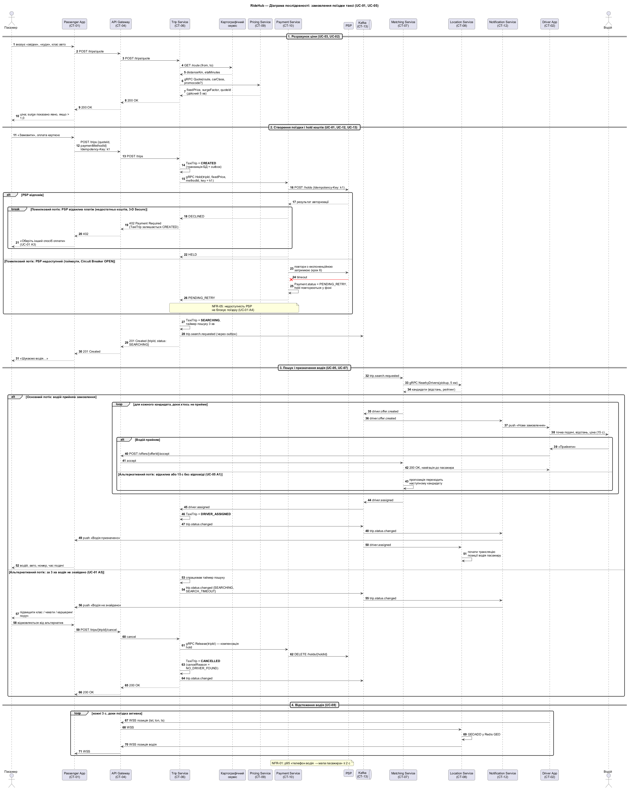
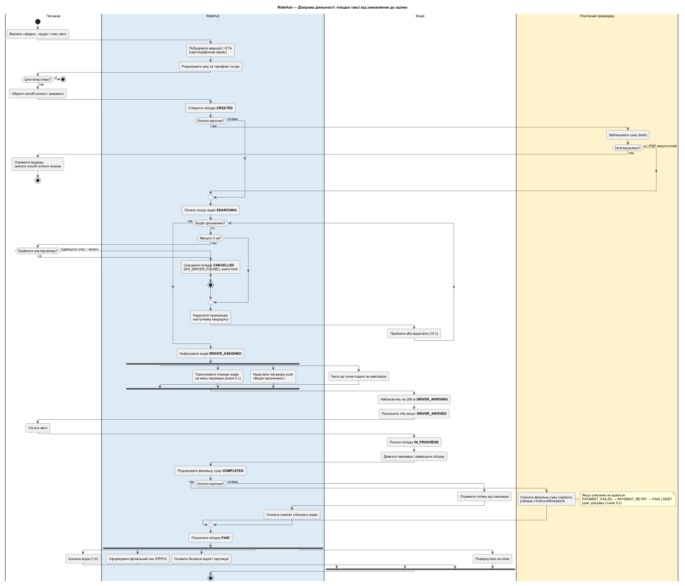
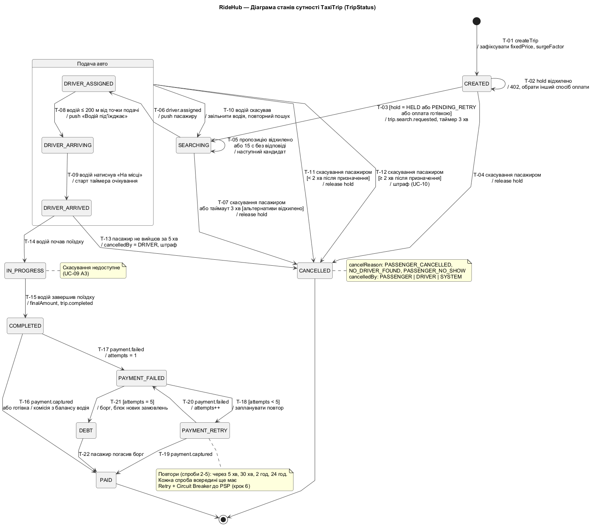

# 5. Поведінкові діаграми

> Технічна вимога №5 · Напрям 3 — діаграма станів поїздки

Три діаграми описують один критичний сценарій — поїздку таксі — з трьох боків:

| Діаграма | Питання, на яке відповідає | Учасники |
|---|---|---|
| Послідовності (5.1) | **Хто кого і в якому порядку викликає**, включно з відмовами | Контейнери C4 (CT-01…CT-13) і зовнішні системи |
| Діяльності (5.2) | **Що відбувається в бізнес-процесі** і що виконується паралельно | Ролі: пасажир, RideHub, водій, PSP |
| Станів (5.3) | **Через які стани проходить поїздка** і що дозволено в кожному | Сутність `TaxiTrip` (доменна модель, крок 3) |

Спільний словник:
- стани — лише значення `TripStatus` з [доменної моделі](03-uml-models.md#статуси), літера в літеру;
- учасники — контейнери з [C4 Container](04-architecture-style-c4.md#контейнери);
- події — топіки Kafka з [розділу 4.4](04-architecture-style-c4.md#основні-топіки-kafka).

Нових статусів, сервісів чи топіків цей крок не вводить.

## 5.1. Діаграма послідовності: замовлення поїздки

Джерело: [`diagrams/05-seq-order-trip.puml`](../diagrams/05-seq-order-trip.puml)

**Сценарій:** UC-01 «Замовити поїздку» з включеними UC-02, UC-03, UC-05, UC-07, UC-12, UC-13 та UC-08 «Відстежити водія».
**Вимоги:** US-02, US-03, US-04, US-06, US-16 · NFR-01, NFR-05, NFR-16 · ASR-01, ASR-03, ASR-04.

### Фази

| Фаза | Що відбувається | Тип взаємодії |
|---|---|---|
| 1. Розрахунок ціни | Trip Service отримує маршрут у картографічного сервісу і ціну в Pricing; ціна дійсна 5 хв (US-02) | Синхронно: REST, gRPC — користувач чекає |
| 2. Створення поїздки | `TaxiTrip = CREATED`, hold коштів через Payment → PSP, перехід у `SEARCHING`, подія `trip.search.requested` через outbox | Синхронно до hold; подія — асинхронно |
| 3. Пошук водія | Matching бере кандидатів у Location, по черзі надсилає пропозиції; призначення повертається в Trip подією `driver.assigned` | Асинхронно (Kafka) + REST для відповіді водія |
| 4. Відстеження | Позиції водія кожні 3 с: Driver App → Location → Passenger App | WebSocket |

### Альтернативні та помилкові потоки

| Фрагмент | Тип | Умова | Що відбувається | Посилання |
|---|---|---|---|---|
| `break` у фазі 2 | Помилковий | PSP відхилив hold (недостатньо коштів, 3-D Secure) | Сценарій зупиняється: 402, `TaxiTrip` залишається `CREATED`, пасажир обирає інший спосіб оплати | UC-01 A3, перехід T-02 |
| `alt … else` у фазі 2 | Помилковий | PSP недоступний: таймаути, Circuit Breaker у стані OPEN | Payment повертає `PENDING_RETRY`, hold повторюється у фоні, поїздка **не блокується** | UC-01 A4, NFR-05, ASR-03 |
| `alt` у фазі 3 | Альтернативний | Водій відхилив або не відповів за 15 с | Пропозиція переходить до наступного кандидата | UC-05 A1, T-05 |
| `alt … else` у фазі 3 | Альтернативний | За 3 хв водія не знайдено | Пасажиру пропонують альтернативи; якщо він відмовився — компенсація hold (`Release`) і `CANCELLED` (`NO_DRIVER_FOUND`) | UC-01 A5, T-07 |

### Проєктні рішення, які видно на діаграмі

1. **Ідемпотентність.** `POST /trips` несе `Idempotency-Key`, і той самий ключ передається в Payment і PSP. Якщо зв'язок у пасажира зник і застосунок повторив запит, дубля поїздки або hold не виникне (NFR-16, UC-01 A7).
2. **Таймер пошуку належить Trip Service.** Trip є оркестратором Saga (крок 3, BC-01), тому саме він вирішує, коли пошук вважається невдалим, і запускає компенсацію `Release`. Matching лише виконує пошук.
3. **Подія `trip.search.requested` публікується через outbox.** Зміна статусу і подія записуються в одній локальній транзакції, тож неможливо отримати поїздку в `SEARCHING`, про яку Matching ніколи не дізнається (ASR-04).
4. **Сповіщення — тільки через Kafka.** Trip і Matching не викликають Notification напряму (Observer, крок 3), тож збій сповіщень не зупиняє поїздку (NFR-05).

## 5.2. Діаграма діяльності: наскрізний бізнес-процес

Джерело: [`diagrams/05-activity-trip-process.puml`](../diagrams/05-activity-trip-process.puml)

**Процес:** від введення адреси до оцінки водія.
**Доріжки (swimlanes):** Пасажир (ST-01), RideHub (система загалом), Водій (ST-03), Платіжний провайдер (ST-07).

Діаграма свідомо показує RideHub однією доріжкою: вона про бізнес-процес, а не про сервіси. Розподіл по сервісах показано в 5.1.

### Рішення (decision nodes)

| Рішення | Гілки | Посилання |
|---|---|---|
| Ціна влаштовує? | так → замовлення; ні → кінець | US-02 |
| Оплата карткою? | так → hold у PSP; готівка → без hold | US-06 |
| Hold відхилено? | так → кінець, пасажир змінює спосіб оплати; ні або PSP недоступний → пошук | UC-01 A3, A4 |
| Водія призначено? (цикл) | ні → наступний кандидат; так → призначення | UC-05 |
| Минуло 3 хв? → Прийняти альтернативу? | ні → `CANCELLED` (`NO_DRIVER_FOUND`), hold знято; так → продовжити пошук | UC-01 A5 |
| Оплата карткою? (після поїздки) | так → capture у PSP; готівка → комісія з балансу водія | US-06, US-17 |

### Паралельні гілки (fork / join)

| Розгалуження | Паралельні дії | Чому паралельно |
|---|---|---|
| Після призначення водія | водій їде до точки подачі ∥ RideHub транслює позицію на мапу пасажира ∥ RideHub надсилає push «Водія призначено» | Дії незалежні: позиція і сповіщення йдуть різними каналами (WebSocket і Kafka → Notification) і не повинні чекати одна одну |
| Після оплати | фіскальний чек у ПРРО ∥ оновлення балансів водія і партнера ∥ пасажир оцінює водія ∥ водій повертається на лінію | Жодна з дій не залежить від іншої; ПРРО може бути недоступний (US-08), і це не повинно затримувати водія чи оцінку |

Збій capture показано приміткою з посиланням на діаграму станів, а не окремою гілкою. Так основний бізнес-процес лишається читабельним.

## 5.3. Діаграма станів сутності TaxiTrip

Джерело: [`diagrams/05-state-trip.puml`](../diagrams/05-state-trip.puml)

**Сутність:** `TaxiTrip.status : TripStatus` — **12 станів**, усі значення переліку з доменної моделі. Складений стан **«Подача авто»** групує `DRIVER_ASSIGNED`, `DRIVER_ARRIVING`, `DRIVER_ARRIVED`: з будь-якого з них можливе скасування. Сам він не є значенням `TripStatus`.

### Стани

| Стан | Зміст | Тип |
|---|---|---|
| `CREATED` | Поїздку створено, ціну зафіксовано, триває hold | Проміжний |
| `SEARCHING` | Пошук водія, діє таймер 3 хв | Проміжний |
| `DRIVER_ASSIGNED` | Водій прийняв замовлення і їде до пасажира | Проміжний |
| `DRIVER_ARRIVING` | Водій ближче ніж 200 м до точки подачі | Проміжний |
| `DRIVER_ARRIVED` | Водій на місці, триває безкоштовне очікування | Проміжний |
| `IN_PROGRESS` | Поїздка триває; скасування недоступне | Проміжний |
| `COMPLETED` | Поїздку завершено, фінальну суму розраховано, триває оплата | Проміжний |
| `PAID` | Оплачено (capture або готівка) | **Кінцевий** |
| `CANCELLED` | Скасовано пасажиром, водієм або системою | **Кінцевий** |
| `PAYMENT_FAILED` | Списання не вдалося | Проміжний |
| `PAYMENT_RETRY` | Запланована повторна спроба списання | Проміжний |
| `DEBT` | Спроби вичерпано, пасажир має борг | Проміжний (до погашення) |

### Переходи

Формат UML: *подія [guard] / дія*.

| ID | Із → у | Подія | Guard | Дія | Ініціатор |
|---|---|---|---|---|---|
| T-01 | ● → `CREATED` | `createTrip` | — | Зафіксувати `fixedPrice`, `surgeFactor` | Пасажир (POST /trips) |
| T-02 | `CREATED` → `CREATED` | Hold відхилено | — | 402, пасажир обирає інший спосіб оплати | Payment / PSP |
| T-03 | `CREATED` → `SEARCHING` | Hold завершено | hold = `HELD` або `PENDING_RETRY`, або готівка | `trip.search.requested`, таймер 3 хв | Trip Service |
| T-04 | `CREATED` → `CANCELLED` | Скасування | — | Release hold | Пасажир |
| T-05 | `SEARCHING` → `SEARCHING` | Пропозицію відхилено або 15 с | — | Наступний кандидат | Matching |
| T-06 | `SEARCHING` → `DRIVER_ASSIGNED` | `driver.assigned` | — | Push пасажиру | Matching → Trip |
| T-07 | `SEARCHING` → `CANCELLED` | Скасування або таймаут 3 хв | альтернативи відхилено | Release hold, `NO_DRIVER_FOUND` | Пасажир / Trip |
| T-08 | `DRIVER_ASSIGNED` → `DRIVER_ARRIVING` | Водій ≤ 200 м | — | Push «Водій під'їжджає» (US-04) | Driver App (геозона 200 м) → Trip, REST |
| T-09 | `DRIVER_ARRIVING` → `DRIVER_ARRIVED` | «На місці» | — | Старт таймера очікування | Водій |
| T-10 | «Подача авто» → `SEARCHING` | Водій скасував | — | Звільнити водія, повторний пошук | Водій |
| T-11 | «Подача авто» → `CANCELLED` | Скасування | < 2 хв після призначення | Release hold (безкоштовно) | Пасажир |
| T-12 | «Подача авто» → `CANCELLED` | Скасування | ≥ 2 хв після призначення | Штраф (UC-10) | Пасажир |
| T-13 | `DRIVER_ARRIVED` → `CANCELLED` | Пасажир не вийшов за 5 хв | — | `cancelledBy = DRIVER`, штраф | Водій |
| T-14 | `DRIVER_ARRIVED` → `IN_PROGRESS` | «Почати поїздку» | — | — | Водій |
| T-15 | `IN_PROGRESS` → `COMPLETED` | «Завершити поїздку» | — | `finalAmount`, `trip.completed` | Водій |
| T-16 | `COMPLETED` → `PAID` | `payment.captured` або готівка | — | Для готівки — комісія з балансу водія | Payment / Trip |
| T-17 | `COMPLETED` → `PAYMENT_FAILED` | `payment.failed` | — | `attempts = 1` | Payment |
| T-18 | `PAYMENT_FAILED` → `PAYMENT_RETRY` | Таймер повтору | attempts < 5 | Запланувати повтор | Payment |
| T-19 | `PAYMENT_RETRY` → `PAID` | `payment.captured` | — | — | Payment |
| T-20 | `PAYMENT_RETRY` → `PAYMENT_FAILED` | `payment.failed` | — | `attempts++` | Payment |
| T-21 | `PAYMENT_FAILED` → `DEBT` | — | attempts = 5 | Борг, блокування нових замовлень | Trip |
| T-22 | `DEBT` → `PAID` | Пасажир погасив борг | — | — | Пасажир |

Кожен перехід публікує `trip.status.changed` через outbox. На цю подію підписані Notification і Location (розділ 4.4).

### Чого немає на діаграмі і чому

- **Скасування з `IN_PROGRESS`.** Його заборонено (UC-09 A3), тому переходу немає. Це також прибирає компенсацію для частково виконаної поїздки.
- **Повернення з `PAID` чи `CANCELLED`.** Обидва стани кінцеві. Повернення коштів за скаргою (US-20) змінює `Payment`, а не статус поїздки.

### Доповнення до попередніх кроків

Ці правила в кроках 2–3 не були описані явно. Їх додано, щоб автомат був повним:
- **T-10 Водій скасував після призначення** — поїздка повертається в пошук, а не скасовується. Так пасажир не втрачає замовлення через водія.
- **T-13 Пасажир не вийшов за 5 хв** — скасування з ініціативи водія зі штрафом.
- **Розклад повторів списання** (T-18): спроби 2–5 через 5 хв, 30 хв, 2 год і 24 год. Це **бізнес-рівень повторів**. Кожна окрема спроба всередині ще має технічний Retry з експоненційною затримкою і Circuit Breaker до PSP (крок 6). Рівні різні: технічний триває секунди, бізнес-рівень — години.

### Зв'язок із Saga (крок 6)

| Крок Saga «пошук водія → підтвердження → оплата» | Переходи | Компенсація |
|---|---|---|
| Створити поїздку | T-01 | Скасувати поїздку (T-04) |
| Hold коштів | T-03 | Release hold (T-04, T-07, T-11) |
| Пошук і резерв водія | T-05, T-06 | Звільнити водія (T-10) |
| Підтвердження водієм | T-06 | Повернути в пошук (T-10) або скасувати (T-07) |
| Capture після поїздки | T-16…T-22 | Refund (поза автоматом, US-20) |

## 5.4. Узгодженість

| Перевірка | Результат |
|---|---|
| Стани на 5.1, 5.2, 5.3 = `TripStatus` з доменної моделі | ✅ 12 з 12; нових значень немає |
| Учасники 5.1 = контейнери C4 | ✅ CT-01, CT-02, CT-04, CT-06…CT-10, CT-12, CT-13 + Maps, PSP |
| Протоколи 5.1 = зв'язки на C4 Container | ✅ Trip → Pricing / Payment — gRPC; Payment → PSP — REST; Matching → Location — gRPC; позиції — WebSocket; решта — Kafka |
| Події 5.1 = топіки Kafka з 4.4 | ✅ `trip.search.requested`, `driver.offer.created`, `driver.assigned`, `trip.status.changed`, `trip.completed`, `payment.captured`, `payment.failed` |
| Альтернативні потоки = специфікації UC-01, UC-05, UC-09 | ✅ A3, A4, A5 з UC-01; A1 з UC-05; A3 з UC-09 |
| Пороги = вимоги кроку 2 | ✅ 15 с (US-16), 3 хв (US-03), 2 хв безкоштовного скасування (US-05), 200 м (US-04), 3 с позиції (NFR-01) |

Нове для кроку 6: ендпоінт `POST /trips/quote` (фаза 1), `POST /trips/{tripId}/cancel` і `POST /offers/{offerId}/accept`. Їх треба включити в API-контракт.
