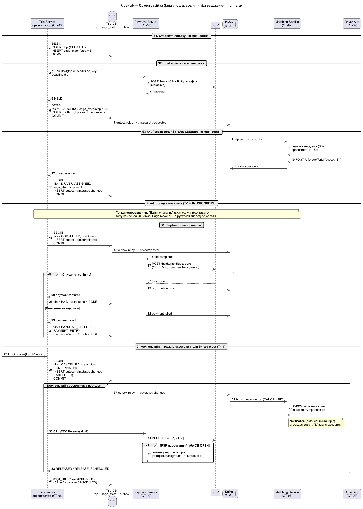
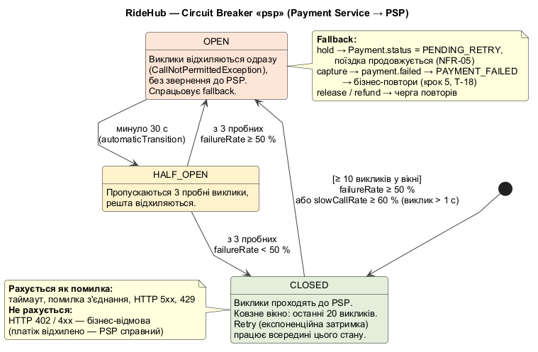

# 6. Розподілена взаємодія

> Технічна вимога №6 · Напрям 2 — синхронні/асинхронні інтеграції з картографічним і платіжним сервісами, Saga «пошук водія → підтвердження → оплата»

Розділ деталізує стрілки з [C4 Container](04-architecture-style-c4.md#зв'язки-та-протоколи) для критичного сценарію і відповідає на три питання:
1. чому кожна інтеграція синхронна чи асинхронна (6.1);
2. як виглядає зовнішній контракт (6.2);
3. як зберегти узгодженість (6.3) і стійкість (6.4) без розподіленої ACID-транзакції.

## 6.1. Каталог інтеграцій

### Критерії вибору типу

| Обираємо **синхронну** взаємодію, коли… | Обираємо **асинхронну** взаємодію, коли… |
|---|---|
| результат потрібен **зараз**, щоб продовжити (користувач чекає на екрані) | відправнику не потрібна відповідь, щоб продовжити |
| операція коротка (≤ 1–2 с) і має чіткий таймаут | операція довга або залежить від людини (водій відповідає до 15 с) |
| один отримувач | кілька незалежних отримувачів (fan-out) |
| відмову треба показати користувачу одразу | потрібен буфер для пікових сплесків (ASR-02) або ізоляція відмов (ASR-03) |

### Синхронні інтеграції

| ID | Інтеграція | Протокол | Обґрунтування типу | Поведінка при відмові |
|---|---|---|---|---|
| INT-01 | Trip Service → **Картографічний сервіс** (маршрут, ETA) | HTTPS/REST, таймаут 1,5 с | Без маршруту немає ціни, а пасажир чекає на екрані з ціною (US-02). Відповідь потрібна в межах того самого запиту `POST /trips/quote`. | Circuit Breaker «maps». Спершу перемикання на резервного провайдера (Google Maps ↔ Visicom) за ≤ 30 с (NFR-05), далі кеш маршрутів між популярними геозонами. Якщо нічого не допомогло — `503` з `Retry-After`. |
| INT-02 | Trip Service → Pricing Service (розрахунок ціни) | gRPC, deadline 300 мс | Критичний шлях того ж запиту; gRPC дає бінарний протокол і строгий контракт `.proto`. Асинхронність тут лише додала б кореляцію відповіді без жодної користі. | Retry 1 раз (операція ідемпотентна, лише читання). Pricing stateless і масштабується горизонтально (ASR-02). |
| INT-03 | Trip Service → Payment Service → **PSP** (hold, release) | gRPC (deadline 5 с) → HTTPS/REST | Від hold залежить, чи можна починати пошук водія (UC-01 A3): результат «відхилено» треба показати пасажиру відразу (402). | **Критична інтеграція:** Circuit Breaker + Retry з експоненційною затримкою (6.4). Якщо PSP недоступний — `PENDING_RETRY`, поїздка продовжується (NFR-05). |
| INT-04 | Matching Service → Location Service (водії в радіусі) | gRPC, deadline 200 мс | Запит до геоіндексу всередині алгоритму матчингу; без кандидатів не можна надіслати пропозицію. | Retry 2 рази з затримкою 50 мс; Location має кілька реплік на місто. |

### Асинхронні інтеграції

| ID | Інтеграція | Канал | Обґрунтування типу | Поведінка при відмові |
|---|---|---|---|---|
| INT-05 | Driver App → Location Service → `driver.location.updated` | WebSocket → Kafka | До 8 300 повідомлень/с у пік (ASR-01). Відправнику не потрібна відповідь, втрата окремої точки допустима, а споживачів кілька (аналітика, діагностика треків). Синхронний REST на кожну точку вичерпав би з'єднання. | Клієнт буферизує до 60 с точок при втраті зв'язку (NFR-16). Kafka зберігає події 24 год; споживачі читають у своєму темпі. |
| INT-06 | Trip Service → `trip.search.requested` → Matching → `driver.assigned` → Trip | Kafka | Пошук водія триває до 3 хв і залежить від людини (15 с на відповідь), тому тримати HTTP-з'єднання стільки часу не можна. Kafka також буферизує сплеск замовлень (50/с у пік, ASR-02). | Подія записується через Transactional Outbox і не губиться при збої. Повторна доставка безпечна, бо споживач ідемпотентний (6.3). Тайм-аут пошуку контролює Trip (оркестратор). |
| INT-07 | Trip Service → `trip.completed` → Payment (capture), Notification | Kafka | Після завершення поїздки водій і пасажир не повинні чекати на PSP. Подію отримують кілька незалежних споживачів (fan-out). | Якщо Payment недоступний, подія чекає в Kafka. Невдалий capture → `payment.failed` → бізнес-повтори (крок 5, T-18). |
| INT-08 | **PSP** → Payment Service (webhook результату) | HTTPS callback, підпис HMAC | Деякі операції PSP завершуються пізніше (3-D Secure, асинхронний capture, refund). Опитування PSP було б марною витратою квоти і затримкою. | Payment перевіряє HMAC, дедуплікує за `eventId` і відповідає `200` лише після запису в БД. PSP повторює доставку при не-2xx. Щоденна звірка з PSP ловить втрачені webhook-и (NFR-07). |
| INT-09 | Payment Service → ПРРО (фіскальний чек) | Внутрішня черга повторів → HTTPS/REST | Чек не потрібен для завершення поїздки, а ПРРО може бути недоступний (US-08). | Повтори з експоненційною затримкою до 72 год. Пасажир отримує чек після відновлення ПРРО без жодних дій. |

**Підсумок:** 4 синхронні (INT-01…04) і 5 асинхронних (INT-05…09) інтеграцій. Обидві інтеграції, яких вимагає тема, присутні в обох формах:
- **картографічний сервіс:** синхронно INT-01, плюс ETA подачі з Location;
- **платіжний провайдер:** синхронно INT-03 (hold) і асинхронно INT-07 (capture) та INT-08 (webhook).

## 6.2. Специфікація API-контракту

Файл: [`api/trip-api.yaml`](../api/trip-api.yaml) — OpenAPI 3.0.3, Trip Service (CT-06) через API Gateway.

| Метод і шлях | Призначення | Успіх | Помилки |
|---|---|---|---|
| `POST /v1/trips/quote` | Розрахувати ціну (UC-02, UC-03) | `200` Quote, дійсний 5 хв | 400, 401, 422 (поза зоною), 429, 503 |
| `POST /v1/trips` | Замовити поїздку, запустити Saga (UC-01) | `201` Trip у статусі `SEARCHING` | 400, 401, **402** (hold відхилено), **409** (ключ з іншим тілом, активна поїздка або борг), **422** (quote прострочено), 429, 503 |
| `GET /v1/trips/{tripId}` | Стан поїздки (UC-08) | `200` Trip | 401, 404 |
| `POST /v1/trips/{tripId}/cancel` | Скасувати поїздку (UC-09, UC-10) | `200` Trip у статусі `CANCELLED` | 401, 404, **409** (стан не дозволяє або потрібне підтвердження штрафу) |

**Ключові рішення контракту**
- **Ідемпотентність.** `Idempotency-Key` (UUID) обов'язковий для `POST /trips` і `/cancel`. Сервер зберігає ключ разом з відповіддю 24 год. Повтор після втрати зв'язку повертає ту саму поїздку (NFR-16, UC-01 A7). Цей самий ключ Payment передає PSP для hold.
- **Асинхронний результат.** `201` означає «поїздку створено, водія шукаємо». Призначення водія клієнт отримує push-ом, через WebSocket-канал `trackingChannel` або через `GET /trips/{tripId}`. Так HTTP-запит не висить 3 хв.
- **Стани в контракті = стани домену.** `status` використовує `TripStatus` (крок 3, крок 5) без змін, а `paymentStatus` — `PaymentStatus` (6.3).
- **Помилки** у форматі RFC 7807 з `traceId` (NFR-13). Гроші передаються в копійках (ціле число), щоб уникнути похибок округлення.
- **Версіонування** у шляху (`/v1`). Несумісні зміни виходять як `/v2`, а `/v1` живе ще 6 місяців: мобільні застосунки оновлюються не одразу.
- **Безпека.** Bearer JWT від Identity Service (CT-05). Gateway перевіряє токен і rate limit, а Trip Service — що поїздка належить користувачу (інакше `404`, а не `403`, щоб не розкривати існування чужих ID).

Відповідь водія на пропозицію (`POST /offers/{offerId}/accept`) належить API Matching Service. Вона не входить у цей спрощений контракт.

## 6.3. Saga «пошук водія → підтвердження → оплата»

Джерело: [`diagrams/06-saga-orchestration.puml`](../diagrams/06-saga-orchestration.puml)



### Чому Saga

Сценарій змінює дані в трьох сервісах із власними БД (Trip, Payment, Matching) і в зовнішньому PSP. Розподілена транзакція 2PC тут неможлива з трьох причин:
- PSP не бере участі в 2PC;
- блокування ресурсів на хвилини пошуку водія суперечить ASR-02;
- координатор 2PC — єдина точка відмови (ASR-03).

Тому обрано **eventual consistency + Saga**: послідовність локальних транзакцій, де кожен крок має компенсацію (ASR-04). Рішення фіксується в ADR-002 (крок 7).

### Оркестрація чи хореографія

| Критерій | Хореографія | Оркестрація | Наш вибір |
|---|---|---|---|
| Видимість стану процесу | Розмазана по подіях; щоб дізнатися, де «застрягла» поїздка, треба збирати події з кількох сервісів | В одному місці: `saga_state` у Trip DB | Оркестрація: диспетчеру потрібно бачити проблемні поїздки (US-18) |
| Тайм-аути (пошук 3 хв) | Хто відповідає за таймер — неочевидно | Таймер в оркестраторі | Оркестрація |
| Порядок компенсацій | Кожен сервіс має знати, на які чужі події реагувати | Оркестратор запускає компенсації у зворотному порядку | Оркестрація |
| Зв'язність | Слабша: немає центрального учасника | Учасники не знають один про одного, але знають про оркестратор | Прийнятно: процес лінійний, учасників 3 |
| Ризик «God-сервісу» | Немає | Оркестратор може обрости логікою | Пом'якшення: Trip лише керує кроками; ціна, матчинг і платежі — в учасниках |

**Висновок:** процес лінійний, критичний для грошей і має тайм-аути, тож обрано **оркестраційну Saga**. Оркестратор — **Trip Service** (BC-01), що збігається з кроками 3–4.

### Кроки і компенсації

Типи транзакцій Saga:
- **компенсовна** — її можна скасувати компенсацією;
- **pivot** — точка неповернення;
- **повторювана** — гарантовано завершується повторами.

| Крок | Учасник | Транзакція | Тип | Компенсація | Переходи `TripStatus` (крок 5) |
|---|---|---|---|---|---|
| S1 | Trip | Створити поїздку, зафіксувати ціну | Компенсовна | **C1:** поїздка → `CANCELLED` | T-01; C1 — T-04, T-07, T-11 |
| S2 | Payment + PSP | Hold `fixedPrice` на картці (для готівки — пропускається) | Компенсовна | **C2:** release hold | T-03; C2 — разом із C1 |
| S3 | Matching | Знайти й зарезервувати кандидата | Компенсовна | **C3:** зняти резерв, анулювати пропозицію | T-05 |
| S4 | Matching → Trip | Водій підтвердив → `driver.assigned` | Компенсовна | **C4:** звільнити водія; якщо скасував водій — повернення в пошук (T-10) | T-06…T-09 |
| — | Trip | **Поїздка почалась** | **Pivot** | — (послугу надано) | T-14 |
| S5 | Payment + PSP | Capture `finalAmount` | **Повторювана** | Немає. Повтори: технічні (6.4) і бізнесові (T-18…T-21) → `PAID` або `DEBT` | T-15…T-22 |

Компенсації виконуються **у зворотному порядку**: C4/C3 → C2 → C1. Технічно C1 (статус `CANCELLED`) записується першим, у тій самій локальній транзакції, що й подія `trip.status.changed`. Саме ця подія запускає C3/C4 у Matching, тому поїздку неможливо скасувати, «забувши» звільнити водія.

Повернення коштів після оплати (US-20) **не є компенсацією Saga**. Це окрема бізнес-операція над `Payment`, що не змінює статус поїздки (крок 5).

### Механізми, що роблять Saga надійною

| Механізм | Де | Що гарантує |
|---|---|---|
| **Transactional Outbox** | Trip DB, Payment DB | Зміна стану і подія записуються в одній локальній транзакції. Окремий relay публікує outbox у Kafka. Подія не губиться і не з'являється без зміни стану |
| **Ідемпотентні споживачі** | Усі споживачі Kafka | Таблиця `processed_events(eventId)`: повторно доставлена подія (at-least-once) не обробляється двічі |
| **Ключ партиції = `tripId`** | Kafka | Усі події однієї поїздки читаються в порядку публікації |
| **`saga_state`** | Trip DB | Поточний крок, дедлайни, статус (`RUNNING`, `COMPENSATING`, `COMPENSATED`, `DONE`). Після перезапуску Trip продовжує незавершені Saga |
| **Дедлайни** | Trip (оркестратор) | Hold — 5 с; пошук водія — 3 хв; пропозиція водію — 15 с (у Matching) |
| **Ідемпотентні ключі до PSP** | Payment | Hold — `Idempotency-Key` клієнта; capture, release, refund — `{tripId}:{operation}`. Повтор не створює другого списання (NFR-07) |
| **Щоденна звірка з PSP** | Payment | Розбіжності (втрачений webhook, «завислий» hold) виявляються та виправляються ≤ 24 год |

### Статуси платежу

Перелік `PaymentStatus` використовувався в кроках 3 і 5, але не був визначений. Додано в доменну модель (BC-05):

| Статус | Зміст | Звідки |
|---|---|---|
| `CREATED` | Платіж створено, до PSP ще не звертались | S2 |
| `HELD` | Сума заблокована на картці | S2 успішний |
| `PENDING_RETRY` | PSP недоступний; hold або capture повторюється у фоні | Fallback Circuit Breaker (6.4) |
| `DECLINED` | PSP відхилив hold (бізнес-відмова) | S2 → 402 |
| `RELEASED` | Hold знято | Компенсація C2 |
| `CAPTURED` | Кошти списано | S5 успішний |
| `FAILED` | Списання не вдалося | S5 → `PAYMENT_FAILED` поїздки |
| `REFUNDED` | Кошти повернуто (повністю або частково) | US-20 |

**Прийнятий ризик.** Hold у `PENDING_RETRY` може пізніше бути відхилений, коли поїздка вже триває. Поїздку не скасовуємо: пасажиру пропонується змінити спосіб оплати, а якщо capture не вдасться — спрацьовує шлях `PAYMENT_FAILED → PAYMENT_RETRY → DEBT` (блокування нових замовлень до погашення). Ми свідомо обираємо доступність сервісу (NFR-05) ціною невеликого ризику заборгованості.

## 6.4. Circuit Breaker і Retry з експоненційною затримкою

Джерело: [`diagrams/06-circuit-breaker.puml`](../diagrams/06-circuit-breaker.puml)



### Чому саме Payment Service → PSP

Це **єдина** зовнішня залежність, яка одночасно:
- стоїть на критичному шляху замовлення (hold перед пошуком водія, INT-03);
- працює з грошима, тож повтор без ідемпотентності означає подвійне списання (NFR-07);
- поза нашим контролем: має власні збої, таймаути і rate limits.

Без захисту завислий PSP вичерпує потоки Payment Service, Trip Service чекає на gRPC-deadline, і зупиняється все замовлення поїздок. Це каскадна відмова, проти якої спрямована ASR-03.

### Композиція захисних механізмів

```
Retry ( CircuitBreaker ( Bulkhead ( TimeLimiter ( виклик PSP ) ) ) )
```

- **TimeLimiter** обриває кожен окремий виклик за таймаутом.
- **Bulkhead** обмежує кількість одночасних викликів до PSP, щоб зависання PSP не забрало всі потоки Payment Service.
- **CircuitBreaker** рахує кожну спробу, а коли PSP «лежить», перестає його турбувати.
- **Retry** зовні повторює лише тимчасові помилки і **не повторює**, коли CB відкритий (`CallNotPermittedException`): той самий запит одразу отримає відмову.

### Параметри Circuit Breaker «psp»

| Параметр (Resilience4j) | Значення | Обґрунтування |
|---|---|---|
| `slidingWindowType` | `COUNT_BASED` | Навантаження на PSP нерівномірне, тому вікно за кількістю дає стабільнішу оцінку, ніж за часом |
| `slidingWindowSize` | 20 | ≈ 20 с трафіку в звичайному режимі (5 hold/с + capture) — швидка реакція без шуму |
| `minimumNumberOfCalls` | 10 | Не відкривати CB через 1–2 випадкові помилки після простою |
| `failureRateThreshold` | 50 % | Половина викликів падає — PSP фактично недоступний |
| `slowCallDurationThreshold` | 1 с | Нормальна відповідь PSP — 200–400 мс; > 1 с означає деградацію |
| `slowCallRateThreshold` | 60 % | Масова повільність так само небезпечна, як помилки: тримає потоки |
| `waitDurationInOpenState` | 30 с | Типова тривалість коротких збоїв PSP; узгоджено з NFR-05 (резерв ≤ 30 с) |
| `permittedNumberOfCallsInHalfOpenState` | 3 | Мінімальне пробне навантаження на PSP, що відновлюється |
| `automaticTransitionFromOpenToHalfOpenEnabled` | `true` | Перехід у HALF_OPEN без очікування наступного запиту |
| `recordExceptions` | таймаут, `IOException`, HTTP 5xx, 429 | Ознаки збою PSP |
| `ignoreExceptions` | HTTP 402 та інші 4xx | **Бізнес-відмова** («недостатньо коштів») означає, що PSP справний. Інакше хвиля відмов у пік відкрила б CB для всіх |

### Стратегія Retry: два профілі

Синхронний hold, на який чекає пасажир, і фоновий capture мають різний часовий бюджет, тому профілів два.

| Параметр | Профіль **interactive** (hold, release у запиті) | Профіль **background** (capture, refund, відкладений release) |
|---|---|---|
| `maxAttempts` (разом з першою) | 3 | 5 |
| Початкова затримка | 200 мс | 500 мс |
| Множник | 2 | 2 |
| Максимальна затримка | 1 с | 8 с |
| Jitter (`randomizationFactor`) | ± 20 % | ± 20 % |
| Таймаут одного виклику | 1,2 с | 3 с |
| Найгірший сумарний час | 3 × 1,2 + 0,24 + 0,48 ≈ **4,3 с** < gRPC deadline 5 с | 5 × 3 + (0,5 + 1 + 2 + 4) × 1,2 ≈ **24 с** |
| Повторювати на | таймаут, помилка з'єднання, 5xx, 429 (з урахуванням `Retry-After`) | те саме |
| **Не** повторювати на | 4xx (402 тощо), `CallNotPermittedException` | те саме |
| Після вичерпання | Fallback → `PENDING_RETRY`, поїздка продовжується | `payment.failed` → бізнес-повтори T-18 (5 хв … 24 год) |

**Затримки між спробами** (`delay = initial × multiplier^(n-1)`, ± 20 %):

| Спроба | interactive | background |
|---|---|---|
| 1 | одразу | одразу |
| 2 | 200 мс (160–240) | 500 мс (400–600) |
| 3 | 400 мс (320–480) | 1 с (0,8–1,2) |
| 4 | — | 2 с (1,6–2,4) |
| 5 | — | 4 с (3,2–4,8) |

**Навіщо jitter.** Коли PSP відновлюється, сотні Payment-запитів, що чекали на повтор, інакше вдарили б по ньому одночасно (thundering herd). Випадкове зміщення ± 20 % розподіляє їх у часі.

**Безпечність повторів.** Повторюються лише запити з ідемпотентним ключем (6.3), тому повтор після таймауту, коли PSP насправді вже виконав операцію, не створить другого списання (NFR-07).

### Конфігурація

```yaml
resilience4j:
  circuitbreaker:
    instances:
      psp:
        slidingWindowType: COUNT_BASED
        slidingWindowSize: 20
        minimumNumberOfCalls: 10
        failureRateThreshold: 50
        slowCallDurationThreshold: 1s
        slowCallRateThreshold: 60
        waitDurationInOpenState: 30s
        permittedNumberOfCallsInHalfOpenState: 3
        automaticTransitionFromOpenToHalfOpenEnabled: true
        recordExceptions:
          - java.util.concurrent.TimeoutException
          - java.io.IOException
          - ua.ridehub.payment.psp.PspServerErrorException      # 5xx, 429
        ignoreExceptions:
          - ua.ridehub.payment.psp.PspBusinessDeclineException  # 402, інші 4xx
  retry:
    instances:
      psp-interactive:
        maxAttempts: 3
        waitDuration: 200ms
        enableExponentialBackoff: true
        exponentialBackoffMultiplier: 2
        exponentialMaxWaitDuration: 1s
        enableRandomizedWait: true
        randomizedWaitFactor: 0.2
        retryExceptions: [java.util.concurrent.TimeoutException, java.io.IOException,
                          ua.ridehub.payment.psp.PspServerErrorException]
        ignoreExceptions: [io.github.resilience4j.circuitbreaker.CallNotPermittedException,
                           ua.ridehub.payment.psp.PspBusinessDeclineException]
      psp-background:
        maxAttempts: 5
        waitDuration: 500ms
        enableExponentialBackoff: true
        exponentialBackoffMultiplier: 2
        exponentialMaxWaitDuration: 8s
        enableRandomizedWait: true
        randomizedWaitFactor: 0.2
        retryExceptions: [java.util.concurrent.TimeoutException, java.io.IOException,
                          ua.ridehub.payment.psp.PspServerErrorException]
        ignoreExceptions: [io.github.resilience4j.circuitbreaker.CallNotPermittedException,
                           ua.ridehub.payment.psp.PspBusinessDeclineException]
  bulkhead:
    instances:
      psp:
        maxConcurrentCalls: 50
        maxWaitDuration: 0
  timelimiter:
    instances:
      psp-interactive: { timeoutDuration: 1200ms }
      psp-background:  { timeoutDuration: 3s }
```

> YAML наведено як специфікацію параметрів. Не всі версії Resilience4j дозволяють поєднати `enableExponentialBackoff` і `enableRandomizedWait` у конфігурації, тому в коді інтервал задається явно: `IntervalFunction.ofExponentialRandomBackoff(initial, 2.0, 0.2, max)`.

### Спостереження

Стан CB і лічильники повторів експортуються в метрики (`resilience4j_circuitbreaker_state`, `resilience4j_retry_calls`). Перехід CB у `OPEN` — алерт для чергового SRE (NFR-13, MTTD ≤ 5 хв). Як автоматично перевіряти, що fallback справді працює, описано у fitness function FF-4 (chaos-тест із вимкненим PSP, крок 9).

## 6.5. Узгодженість з іншими розділами

| Перевірка | Результат |
|---|---|
| Інтеграції 6.1 = стрілки на C4 Container | ✅ INT-01…INT-09 є на `04-c4-container` |
| Статуси в API і Saga = `TripStatus` (крок 3) і діаграма станів (крок 5) | ✅ без нових значень |
| `PaymentStatus` визначено | ✅ додано в доменну модель і розділ 3.2 |
| Компенсація C3/C4 має канал доставки | ✅ Matching тепер підписаний на `trip.status.changed` (виправлено на `04-c4-container` і в таблиці топіків 4.4) |
| Fallback CB = переходи діаграми станів | ✅ hold → `PENDING_RETRY` (T-03), capture → `PAYMENT_FAILED` (T-17) |
| Ендпоінти з кроку 5 | ✅ `/trips/quote`, `/trips/{tripId}/cancel` — у контракті; `/offers/{offerId}/accept` — API Matching |
| Рішення для ADR (крок 7) | ADR-002 (eventual consistency + оркестраційна Saga + Outbox), ADR-005 (CB + Retry для PSP) |
