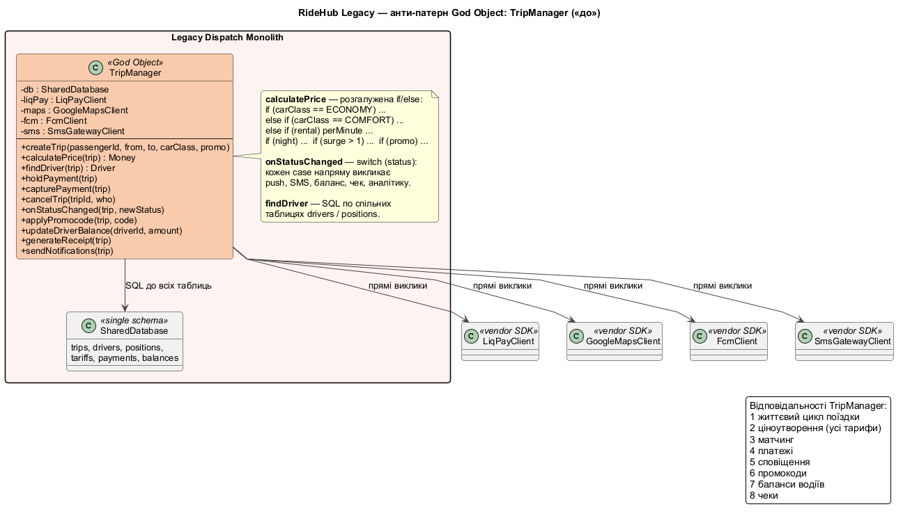
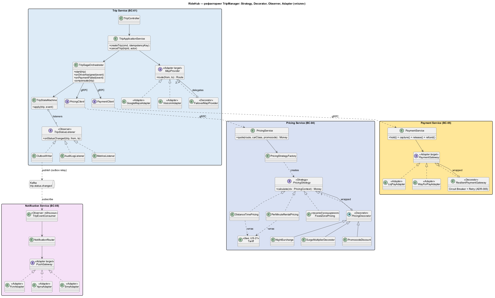
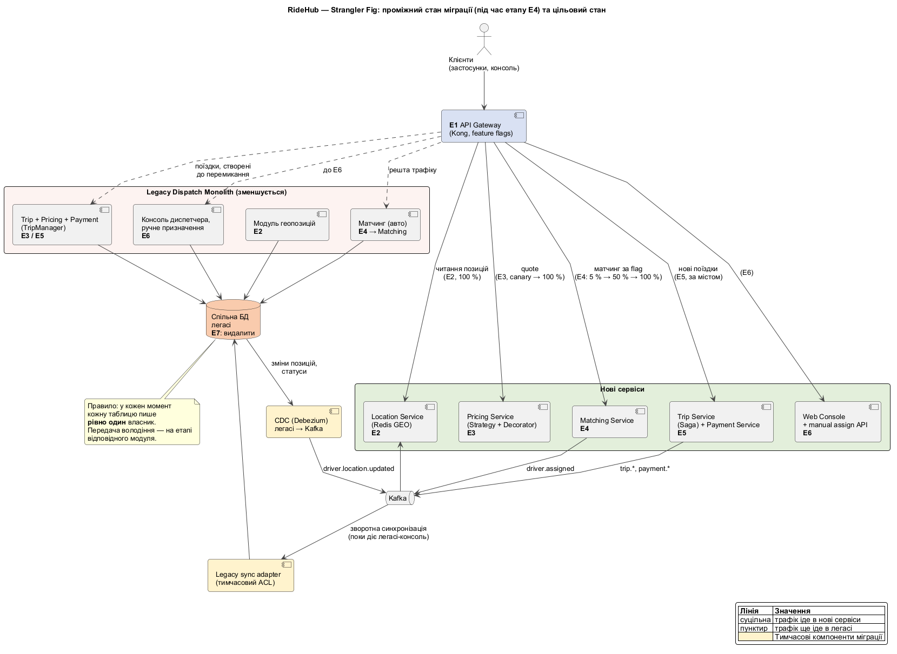

# 8. Анти-патерн і поетапна міграція

> Технічна вимога №8

## 8.0. Сценарій

RideHub починався як MVP: єдиний застосунок **Legacy Dispatch Monolith** з однією спільною БД. Він і досі обслуговує поїздки, а цільова мікросервісна архітектура (ADR-001) будується навколо нього. Такий вихідний стан є припущенням для цього розділу: він дозволяє показати і рефакторинг, і міграцію на реальному класі системи, а не абстрактно.

Розділ відповідає на два питання:
1. Що саме було не так у коді легасі й **як це виправлено** патернами в цільових сервісах (8.1–8.2).
2. **Як перейти** від легасі до нової архітектури без «великого вибуху» (8.3).

## 8.1. Анти-патерн «до»: God Object `TripManager`

Джерело: [`diagrams/08-class-before.puml`](../diagrams/08-class-before.puml)



Клас `TripManager` у легасі — центр системи. Він відповідає за **вісім** різних речей: життєвий цикл поїздки, ціноутворення для всіх тарифів, пошук водія, платежі, сповіщення, промокоди, баланси водіїв і чеки. Він напряму тримає клієнти вендорів (`LiqPayClient`, `GoogleMapsClient`, `FcmClient`, `SmsGatewayClient`) і ходить у спільну БД SQL-запитами до всіх таблиць.

Типові фрагменти (спрощено):

```java
Money calculatePrice(Trip trip) {
    Money price;
    if (trip.isRental()) {
        price = rentalPerMinute(trip);
    } else if (trip.carClass() == ECONOMY) {
        price = base(ECONOMY) + km(trip) * 9 + min(trip) * 2;
    } else if (trip.carClass() == COMFORT) {
        price = base(COMFORT) + km(trip) * 12 + min(trip) * 3;
    } // ... ще 4 класи
    if (isNight(trip))      price = price * 1.2;
    if (surge(trip) > 1.0)  price = price * surge(trip);
    if (trip.promo() != null) price = applyPromo(price, trip.promo());
    return price;
}

void onStatusChanged(Trip trip, Status s) {
    switch (s) {
        case DRIVER_ASSIGNED: fcm.push(...); analytics.log(...); break;
        case COMPLETED:       liqPay.capture(...); updateDriverBalance(...);
                              generateReceipt(...); sms.send(...); break;
        // кожен новий інтерес — ще один case і ще одна залежність
    }
}
```

### Проблеми

| Симптом у коді | Порушений принцип | Наслідок для RideHub |
|---|---|---|
| Один клас змінюється через тарифи, платежі, сповіщення і матчинг | **SRP** | Конфлікти змін у командах, регресії в несуміжних функціях |
| Новий клас авто, новий вендор чи нове правило surge = правка `calculatePrice` / `onStatusChanged` | **OCP** | Новий тариф вимагає релізу (суперечить US-21 і NFR-12); нового партнера підключити за 2 тижні неможливо (NFR-11) |
| Конкретні SDK вендорів усередині бізнес-логіки | **DIP** | Заміна PSP чи картографічного сервісу = переписування ядра; жодного failover (NFR-05) |
| Усе залежить від усього | Високе зв'язування | Юніт-тест розрахунку ціни вимагає БД, PSP і FCM; відтворити помилку можна лише в інтеграційному стенді |
| Збій сповіщень, чеків чи PSP відбувається в тому самому виклику, що й зміна статусу | Відсутня ізоляція відмов | Збій FCM або LiqPay зупиняє завершення поїздки (порушення NFR-05, ASR-03) |
| Пошук водія і платежі в одній процедурі, одна БД | Немає меж | Неможливо масштабувати матчинг окремо в пік (ASR-02) |
| Один розгортуваний артефакт | Розгортання зв'язане | Зміна будь-чого = повний реліз і ризик для всього (NFR-12) |

### Чому не лише God Object

Вторинний ризик — **Distributed Monolith**. Якщо розрізати легасі на сервіси, але залишити спільну БД і ланцюжки синхронних викликів, отримаємо ті самі залежності з мережевими відмовами у придачу. Тому в плані міграції (8.3) володіння даними передається поетапно, а FF-03 (крок 9) перевіряє, що сервіси не ходять у чужі БД (ADR-009).

## 8.2. Рефакторинг «після»

Джерело: [`diagrams/08-class-after.puml`](../diagrams/08-class-after.puml)



Відповідальності `TripManager` розподілено між цільовими сервісами (крок 4), а в кожному сервісі застосовано патерн, що розв'язує конкретну проблему з 8.1.

### Проблема → патерн → чому саме він

| # | Проблема | Патерн | Де | Чому саме він |
|---|---|---|---|---|
| 1 | `if/else` за видом тарифу в `calculatePrice` | **Strategy** | Pricing Service: `PricingStrategy` → `DistanceTimePricing`, `PerMinuteRentalPricing` | Алгоритми розрахунку різні за суттю (відстань + час або хвилини оренди), і їх треба підміняти без правки викликача. Новий алгоритм (наприклад, `FixedZonePricing` для аеропорту) — новий клас, ядро не змінюється (OCP) |
| 2 | Комбінації надбавок: нічна × surge × промокод | **Decorator** | Pricing Service: `NightSurcharge`, `SurgeMultiplierDecorator`, `PromocodeDiscount` обгортають `PricingStrategy` | Надбавки накладаються одна на одну в довільному поєднанні. Через успадкування було б `EconomyNightSurge`, `ComfortNightPromo` тощо: комбінаторний вибух. Decorator складає їх ланцюжком під час виконання |
| 3 | `onStatusChanged` викликає push, SMS, баланси, чеки, аналітику напряму | **Observer** | Trip Service: `TripStateMachine` повідомляє `TripStatusListener` (`OutboxWriter`, `AuditLogListener`, `MetricsListener`); між сервісами — подія `trip.status.changed` у Kafka, підписники Notification, Location, Matching | Тут «один до багатьох»: Trip не повинен знати, хто реагує на зміну статусу. Новий підписник додається без змін у Trip. Через брокер Observer також ізолює відмови: збій Notification не зупиняє поїздку (NFR-05) |
| 4 | Прямі виклики `LiqPayClient`, `GoogleMapsClient`, `FcmClient`, `SmsGatewayClient` | **Adapter** | `PaymentGateway` ← `LiqPayAdapter`, `WayForPayAdapter`; `MapProvider` ← `GoogleMapsAdapter`, `VisicomAdapter`; `PushGateway` ← `FcmAdapter`, `ApnsAdapter`, `SmsAdapter` | Є готові несумісні API вендорів, які треба привести до одного внутрішнього інтерфейсу. Це класична задача Adapter; саме він забезпечує NFR-11 (ADR-007) |
| 5 | Збої PSP вражають бізнес-код | **Decorator** | Payment Service: `ResilientPaymentGateway` обгортає будь-який `PaymentGateway` | Circuit Breaker і Retry (ADR-005) додаються як обгортка над портом, а `PaymentService` про них не знає. Інакше захист довелося б дублювати в кожному адаптері |
| 6 | Немає резервного картографічного сервісу | **Decorator** | Trip Service: `FailoverMapProvider` над `GoogleMapsAdapter` і `VisicomAdapter` | Перемикання провайдера за ≤ 30 с (NFR-05) без змін у викликачах |
| 7 | Один клас керує всім процесом поїздки | Оркестратор Saga | Trip Service: `TripSagaOrchestrator` + `TripStateMachine` (таблиця переходів T-01…T-22) | Це не GoF-патерн, а рішення ADR-002. Оркестратор лише керує кроками, а ціна, матчинг і платежі лежать у своїх сервісах |

### Куди поділися відповідальності `TripManager`

| Було в `TripManager` | Стало | Сервіс |
|---|---|---|
| `createTrip`, `cancelTrip`, життєвий цикл | `TripApplicationService`, `TripSagaOrchestrator`, `TripStateMachine` | Trip |
| `calculatePrice`, `applyPromocode` | `PricingService`, `PricingStrategy` + decorators | Pricing |
| `findDriver` | Matching Service (+ `ILocationQuery` до Location) | Matching, Location |
| `holdPayment`, `capturePayment`, `updateDriverBalance`, `generateReceipt` | `PaymentService`, `PaymentGateway` | Payment |
| `onStatusChanged`, `sendNotifications` | `TripStatusListener` + Kafka-підписники | Trip → Notification |

### Приклад «після»

```java
interface PricingStrategy { Money calculate(PricingContext ctx); }

class DistanceTimePricing implements PricingStrategy {   // параметри з Tariff (БД)
    public Money calculate(PricingContext c) {
        Tariff t = c.tariff();
        return t.baseFare().plus(t.perKm().times(c.km())).plus(t.perMinute().times(c.minutes()));
    }
}

// ланцюжок збирається фабрикою за контекстом, а не if/else у викликачі
PricingStrategy strategy =
    new PromocodeDiscount(
        new SurgeMultiplierDecorator(
            new NightSurcharge(new DistanceTimePricing())));
Money price = strategy.calculate(ctx);
```

### Відхилення від початкового плану і чому

- **`EconomyPricing` / `ComfortPricing` не створюємо.** Економ і комфорт відрізняються лише *параметрами* (базова ставка, ціна за км і хвилину), а не алгоритмом. Тому це дані в `Tariff`, а клас один — `DistanceTimePricing`. Це напряму підтримує US-21 (тарифи змінюються в адмін-панелі без релізу) і NFR-12. Окремі класи стратегій потрібні лише там, де різниться алгоритм.
- **`SurgePricing` — не стратегія, а Decorator.** Surge — множник поверх базової ціни будь-якої стратегії, тому реалізований як надбавка (`SurgeMultiplierDecorator`), що поєднується з нічним тарифом і промокодом.
- **Facade (`TripBookingFacade`) не додаємо.** Його роль виконують `POST /trips` і `TripSagaOrchestrator`: клієнт уже має один виклик для цілого сценарію. Окремий Facade був би патерном заради патерну.
- **Observer реалізовано двома рівнями.** Усередині процесу — `TripStatusListener`, між сервісами — Kafka-події. Це один патерн, але з різною межею розподілу.

### Наслідки

**Плюси.** Кожен клас має одну причину для змін; тарифи і вендори додаються без правки ядра; сервіси тестуються ізольовано (стратегія ціни — чиста функція, адаптери — через заглушки); відмова вендора ізольована.

**Мінуси.** Більше класів та інтерфейсів; ланцюжок decorator-ів складніше відлагоджувати, тому `PricingContext` повертає розбивку ціни (базова, надбавки, знижка) для діагностики й чеків; порядок decorator-ів впливає на результат (знижка застосовується після надбавок) і має бути закріплений тестами.

## 8.3. Міграція за патерном Strangler Fig

Джерело: [`diagrams/08-strangler-fig.puml`](../diagrams/08-strangler-fig.puml)



Легасі не переписуємо одразу. Перед ним ставимо фасад, а функції переносимо в нові сервіси по одній, перемикаючи трафік поступово. Легасі «душиться», доки не лишиться порожнім.

### Принципи

1. **Порядок за ризиком, від низького до високого:** читання → чисті обчислення → стан, що повторюється → гроші → інтерфейси → вимкнення.
2. **Кожен етап має критерій переходу й готовий відкат** до початку, а не після проблеми.
3. **Один власник запису.** У кожен момент кожну таблицю пише рівно один компонент. Володіння передається етапом.
4. **Тимчасові компоненти міграції** (CDC, зворотна синхронізація) явно позначені й видаляються на останньому етапі.
5. **Поточні операції завершуються там, де почались.** Поїздка, створена в легасі, завершується в легасі; нова поїздка йде в нове.

### Етапи

| Етап | Що робимо | Критерій переходу | Ризики | План відкату |
|---|---|---|---|---|
| **E1. Фасад** | Ставимо API Gateway (ADR-008) перед легасі. Весь трафік проходить через нього, логіка не змінюється. Додаємо `trace-id`, метрики, rate limiting | 100 % запитів іде через Gateway; p95 затримки зріс не більше ніж на 10 мс; частка помилок не змінилась | Gateway — нова єдина точка відмови; несумісність WebSocket у легасі | Перемкнути маршрут напряму на легасі (DNS / балансувальник); Gateway лишається в тіні |
| **E2. Геолокація (читання)** | Новий Location Service (ADR-004). Позиції з легасі надходять через CDC (Debezium) у Kafka `driver.location.updated`, пасажирські мапи і консоль читають з нового сервісу. Запис позицій від Driver App зрештою переходить у Location (подвійний запис на перехідний період) | p95 затримки «водій → мапа» ≤ 2 с (NFR-01); розбіжність позицій з легасі ≤ 1 % (ASR-01) | Затримка CDC; пропуски в потоці; помилки TTL | Маршрут читання назад у легасі; Location лишається у фоновому режимі |
| **E3. Ціноутворення** | Новий Pricing Service зі Strategy + Decorator (8.2). **Shadow mode:** запит `quote` виконується в обох системах, пасажир бачить ціну легасі, розбіжності логуються. Тарифи копіюються в Pricing DB. Далі — канарка 5 % → 50 % → 100 % | ≥ 99,9 % цін збігаються до копійки за період спостереження; всі розбіжності пояснені; p95 ≤ 1,5 с (NFR-02) | Розбіжності через неявні правила в `if/else` легасі; різний порядок надбавок | Вимкнути feature flag → ціну знову рахує легасі; ціна вже підтверджена пасажиром не змінюється (US-21) |
| **E4. Матчинг** | Новий Matching Service підбирає водія через Location (gRPC). Feature flag за відсотком і містом: 5 % → 50 % → 100 %. Призначення синхронізується в легасі-БД через **Legacy sync adapter** (тимчасовий ACL), бо консоль диспетчера ще працює на легасі | p95 призначення ≤ 30 с (NFR-02) на кожному кроці; частка скасувань не гірша за базову; помилки < 1 % | Дві системи одночасно призначають одного водія; розбіжності синхронізації; незавершені пропозиції під час перемикання | Flag → 0 %. Незавершені пропозиції доводить до кінця та система, що їх створила. Подвійне призначення блокується унікальним резервом водія |
| **E5. Поїздка і платежі** | Новий Trip Service (оркестраційна Saga) і Payment Service (Outbox, CB + Retry). Перемикаємо **створення нових поїздок** по містах, по одному. Поїздки, створені в легасі, завершуються в легасі (drain). Webhook-и PSP маршрутизуються за ідентифікатором платежу в ту систему, що його створила | Нові поїздки в обраному місті: 0 подвійних списань, щоденна звірка з PSP без розбіжностей (NFR-07), успішність оплат не гірша за базову; Saga без «завислих» hold-ів | **Найвищий ризик: гроші.** Подвійні списання, втрачені webhook-и, поїздка в обох системах | Нові поїздки міста знову створюються в легасі. Уже створені в новій системі завершуються в ній (зворотної міграції немає). Ідемпотентні ключі `{tripId}:{operation}` не дозволяють повторного списання |
| **E6. Консоль і ручне призначення** | Нова Web Console і API ручного призначення (US-18, US-19, US-20) з аудит-журналом (NFR-10). Диспетчери переходять змінами: спочатку пара змін в паралельному режимі | Усі сценарії US-18, US-19, US-20 покриті; диспетчери підтверджують достатність функцій; консоль легасі лише для читання | Втрата навичок і функцій, невидимих у вимогах; затримка реакції на проблемні поїздки | Диспетчер повертається в легасі-консоль, поки вона працює у режимі читання/запису; нова консоль не видаляє даних |
| **E7. Вимкнення легасі** | Легасі-трафік нульовий; видаляємо Legacy sync adapter, CDC і спільні таблиці. Архівний знімок БД зберігається для аудиту (≥ 3 роки, NFR-10) | 0 запитів до легасі протягом узгодженого періоду; остання щоденна звірка з PSP без розбіжностей; дані, потрібні за законом, архівовано | Забуті інтеграції (звіти, партнери), що читають легасі-БД напряму | Відновлення зі знімка допускається лише у вузькому вікні після вимкнення; далі відкату немає, тому критерій входу строгий |

### Дані під час міграції

| Таблиця / дані | Власник на старті | Передача володіння |
|---|---|---|
| Позиції водіїв | Легасі | E2 → Location (Redis GEO), легасі більше не читається |
| Тарифи, промокоди | Легасі | E3 → Pricing DB; на період shadow mode синхронізуються |
| Резерв водія, пропозиції | Легасі | E4 → Matching Store; легасі отримує результат через ACL |
| Поїздки, платежі, баланси | Легасі | E5, за містом і для нових поїздок; старі завершуються в легасі |
| Журнал диспетчерських дій | Легасі | E6 → аудит-журнал нової консолі; старий архівується |

### Чому саме такий порядок

- **Читання (E2) і чисті обчислення (E3)** не змінюють стан, тож їх можна перемикати і повертати без наслідків; E3 ще й перевіряється в shadow mode.
- **Матчинг (E4)** змінює стан, але повторюваний: невдалий пошук можна повторити.
- **Гроші (E5)** лишаємо на момент, коли Gateway, Location, Pricing і Matching уже стабільні, а процес міграції відпрацьовано.
- **Консоль (E6)** переносимо після E5, бо вона спирається на нові API Trip і Payment.

## 8.4. Узгодженість

| Перевірка | Результат |
|---|---|
| Анти-патерн показано на конкретному класі нашої системи | ✅ `TripManager` у Legacy Dispatch Monolith, функції відповідають US-02, US-03, US-05, US-06 |
| Кожна проблема з 8.1 розв'язана конкретним патерном і розподілом відповідальності | ✅ таблиця 8.2 |
| Патерни видно в ADR | ✅ Adapter — ADR-007; Decorator `ResilientPaymentGateway` — ADR-005; Observer через Kafka — ADR-003; оркестратор — ADR-002 |
| Сервіси на `08-class-after` = контейнери C4 | ✅ Trip (CT-06), Pricing (CT-09), Payment (CT-10), Notification (CT-12); порти збігаються з інтерфейсами кроку 3 (`IPricing`, `IPayment`, `IMapProvider`, `IPaymentGateway`, `IPushGateway`) |
| Стани й події | ✅ `TripStateMachine` використовує `TripStatus` і переходи T-01…T-22 (крок 5); події — топіки з 4.4 |
| Міграція використовує ті самі компоненти | ✅ Gateway (CT-04, ADR-008), Location (CT-08), Pricing (CT-09), Matching (CT-07), Trip + Payment (CT-06, CT-10), Web Console (CT-03) |
| Критерії відкату | ✅ є для кожного етапу; для E5 і E7 прямо вказано межі відкату |
| Відхилення від плану | `EconomyPricing`/`ComfortPricing` замінено даними `Tariff`; `SurgePricing` реалізовано як Decorator; етапів міграції 7 замість 5 (додано E3 ціноутворення і E5 поїздки та платежі, бо `TripManager` містить і їх) |
