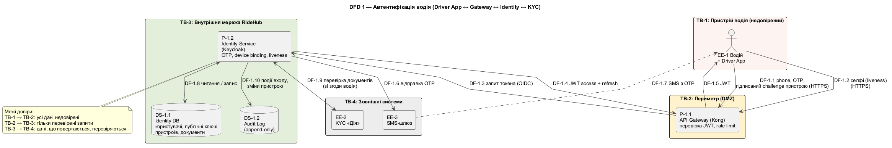
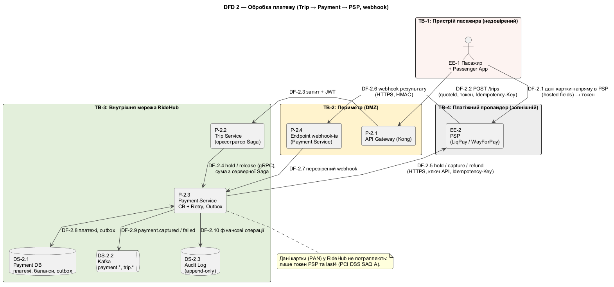
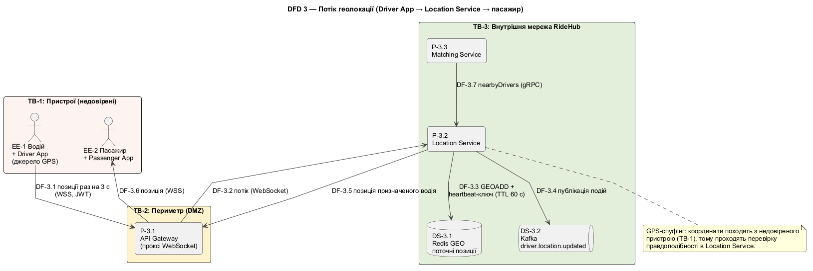

# 9. Моделювання загроз STRIDE і fitness functions

> Технічна вимога №9 · Напрям 3 — STRIDE для автентифікації водія та обробки платежу, fitness functions

Розділ закриває ASR-05 (безпека) з боку аналізу загроз і доводить, що решту ASR можна **перевіряти автоматично**, а не лише декларувати. Загрози виводяться з діаграм потоків даних (DFD) із межами довіри, а контрзаходи посилаються на ADR і fitness functions.

## 9.1. Критичні точки та Data Flow Diagrams

| № | Точка | Чому критична | DFD |
|---|---|---|---|
| 1 | Автентифікація водія | Фейковий або підмінений водій — загроза життю пасажира і ліцензії (ASR-05, NFR-08) | [`09-dfd-driver-auth.puml`](../diagrams/09-dfd-driver-auth.puml) |
| 2 | Обробка платежу | Гроші, PCI DSS, відносини з PSP (ASR-04, ASR-05, NFR-07, NFR-09) | [`09-dfd-payment.puml`](../diagrams/09-dfd-payment.puml) |
| 3 | Потік геолокації | Недовірене джерело даних (GPS пристрою) для матчингу, ціни та відстеження; можливий GPS-спуфінг (ASR-01) | [`09-dfd-geolocation.puml`](../diagrams/09-dfd-geolocation.puml) |

### Межі довіри (trust boundaries)

| ID | Межа | Що довіряємо |
|---|---|---|
| TB-1 | Пристрої користувачів (телефон водія, пасажира) | **Нічому.** Усе, що надходить з пристрою, може бути підроблено (координати, суми, ідентифікатори) |
| TB-2 | Периметр: API Gateway, endpoint webhook-ів | Лише після перевірки JWT, підпису, rate limit |
| TB-3 | Внутрішня мережа RideHub (сервіси, БД, Kafka) | Автентифікованим сервісам (mTLS, scope); дані між контекстами перевіряються на власність |
| TB-4 | Зовнішні системи (PSP, KYC «Дія», SMS) | Лише після перевірки підпису і відповідності нашим даним |

### DFD 1. Автентифікація водія

| Елемент | ID | Опис |
|---|---|---|
| Зовнішні сутності | EE-1, EE-2, EE-3 | Водій з Driver App, KYC «Дія», SMS-шлюз |
| Процеси | P-1.1, P-1.2 | API Gateway; Identity Service (Keycloak) |
| Сховища | DS-1.1, DS-1.2 | Identity DB (користувачі, публічні ключі пристроїв, документи); Audit Log (append-only) |
| Ключові потоки | DF-1.1…DF-1.10 | Вхід (телефон, OTP, підписаний challenge), liveness, видача JWT, відправка OTP, перевірка документів, аудит |

### DFD 2. Обробка платежу

| Елемент | ID | Опис |
|---|---|---|
| Зовнішні сутності | EE-1, EE-2 | Пасажир з Passenger App; PSP |
| Процеси | P-2.1…P-2.4 | Gateway; Trip Service (Saga); Payment Service; endpoint webhook-ів |
| Сховища | DS-2.1…DS-2.3 | Payment DB; Kafka; Audit Log |
| Ключові потоки | DF-2.1…DF-2.10 | Дані картки напряму в PSP (токен); `POST /trips`; hold/capture; webhook PSP; Outbox і події |

### DFD 3. Потік геолокації

| Елемент | ID | Опис |
|---|---|---|
| Зовнішні сутності | EE-1, EE-2 | Водій (джерело GPS); пасажир |
| Процеси | P-3.1…P-3.3 | Gateway (проксі WebSocket); Location Service; Matching Service |
| Сховища | DS-3.1, DS-3.2 | Redis GEO; Kafka `driver.location.updated` |
| Ключові потоки | DF-3.1…DF-3.7 | Позиції водія; запис у індекс; публікація; роздача пасажиру; запит Matching |

## 9.2. Аналіз STRIDE

**Шкала.** Ймовірність (L) і вплив (I) — 1…5. Ризик = L × I: **≥ 15 високий**, **8–14 середній**, **≤ 7 низький**. Залишковий ризик — оцінка після впровадження контрзаходів. Контрзаходи наведено з посиланням на ADR і fitness function, що їх перевіряє.

STRIDE: **S**poofing (підміна особи), **T**ampering (спотворення даних), **R**epudiation (відмова від дій), **I**nformation disclosure (витік), **D**enial of service (відмова в обслуговуванні), **E**levation of privilege (підвищення привілеїв).

### Точка 1. Автентифікація водія

| ID | Кат. | Загроза | Потік | L×I | Контрзахід | Залишок | FF |
|---|---|---|---|---|---|---|---|
| TH-01 | S | Вхід в акаунт перевіреного водія з іншого пристрою: викрадений OTP, SIM-swap | DF-1.1, DF-1.7 | 4×5 = **20 (В)** | OTP + прив'язаний пристрій: підписаний challenge приватним ключем у Keystore / Secure Enclave (ADR-006); новий пристрій → повторна перевірка (OTP + селфі), сповіщення водію та службі безпеки (≤ 15 хв) | 2×5 = 10 (С) | FF-07 |
| TH-02 | S | Передача акаунта іншій, неперевіреній особі (account sharing) | DF-1.2 | 4×4 = **16 (В)** | Liveness-селфі ≥ 1 раз на 7 днів і при вході з нового пристрою (NFR-08); випадкові перевірки перед виходом на лінію; блокування за невідповідність | 3×4 = 12 (С) | FF-07 |
| TH-03 | T | Підміна публічного ключа пристрою (зловмисник реєструє власний пристрій як довірений) або підробка відповіді KYC | DF-1.8, DF-1.9 | 2×5 = 10 (С) | Реєстрація/зміна ключа лише в сесії після OTP + liveness; зміна ключа сповіщає водія; відповіді «Дії» приймаються лише з перевіреним підписом і звіряються з даними заявки; розбіжність → ручна перевірка | 1×5 = 5 (Н) | FF-07 |
| TH-04 | R | Водій заперечує вхід або дії в системі («це був не я») | DF-1.10 | 3×3 = 9 (С) | Незмінний append-only журнал аудиту (NFR-10, ≥ 3 роки); у записі — підписаний challenge пристрою, `device_id`, час (синхронізований); сповіщення водію про вхід | 2×3 = 6 (Н) | FF-07 |
| TH-05 | I | Витік документів і персональних даних водіїв з Identity DB, логів, бекапів | DF-1.8, DF-1.9 | 3×5 = **15 (В)** | Шифрування at rest; поле-рівневе шифрування номерів документів; дані з «Дії» лише зі згоди й мінімально необхідні; жодних PII в логах; RBAC до БД, окремі облікові записи; політика зберігання | 2×5 = 10 (С) | FF-06 |
| TH-06 | D | Флуд OTP: «SMS-pumping» (витрати на SMS) і блокування акаунта жертви через навмисні помилки | DF-1.1, DF-1.6 | 4×3 = 12 (С) | Rate limiting за номером, IP, пристроєм; блокування після 5 помилок на 15 хв (US-01) прив'язане до пари телефон + пристрій, щоб чужий пристрій не блокував жертву; ліміти витрат на SMS | 3×2 = 6 (Н) | FF-07 |
| TH-07 | E | Водій отримує роль диспетчера чи адміна: підміна claims у JWT, надмірні scope | DF-1.4, DF-1.5 | 2×5 = 10 (С) | JWT підписаний (RS256), перевіряється Gateway; ролі призначаються лише сервером, не клієнтом; мінімальні scope; консоль адміністрування Keycloak ізольована від зовнішньої мережі | 1×5 = 5 (Н) | FF-07 |

### Точка 2. Обробка платежу

| ID | Кат. | Загроза | Потік | L×I | Контрзахід | Залишок | FF |
|---|---|---|---|---|---|---|---|
| TH-08 | S | Підроблений webhook «від PSP» з результатом «списано» | DF-2.6 | 3×5 = **15 (В)** | Перевірка HMAC-підпису; timestamp і `eventId` (відсікання повторів); allowlist адрес PSP; для критичних статусів — додаткове підтвердження запитом до API PSP | 1×5 = 5 (Н) | FF-05, FF-06 |
| TH-09 | T | Підміна суми: клієнт передає іншу ціну, або webhook повертає іншу суму | DF-2.2, DF-2.6 | 3×5 = **15 (В)** | Сума завжди береться з серверної Saga (`fixedPrice`); клієнт надсилає `quoteId`, а не суму; сума з webhook звіряється зі станом Saga, розбіжність → алерт і ручна перевірка | 1×5 = 5 (Н) | FF-05 |
| TH-10 | T | Повтор (replay) запиту чи webhook → подвійне списання | DF-2.2, DF-2.6 | 4×4 = **16 (В)** | `Idempotency-Key` для клієнта; ключі `{tripId}:{operation}` до PSP; `processed_events(eventId)`; щоденна звірка з PSP (ADR-002, NFR-07) | 1×4 = 4 (Н) | FF-05 |
| TH-11 | R | Пасажир заперечує оплату (chargeback, «я не замовляв»); сумнів щодо готівкової оплати водія | DF-2.2, DF-2.10 | 4×3 = 12 (С) | 3-D Secure (відповідальність на стороні емітента); append-only аудит із подіями Saga, фіскальний чек (ПРРО); історія поїздки і трек як докази | 3×3 = 9 (С) | FF-05 |
| TH-12 | I | Витік платіжних даних: PAN у логах або БД, токенів PSP, ключів API PSP | DF-2.1, DF-2.5, DF-2.8 | 3×5 = **15 (В)** | PAN у систему не потрапляє: поля картки вводяться в hosted fields PSP (PCI DSS SAQ A, NFR-09); у БД лише токен і last4; ключі в сховищі секретів; TLS 1.2+; маскування логів | 2×5 = 10 (С) | FF-06 |
| TH-13 | D | Флуд `POST /trips` у пік або повільний PSP вичерпують потоки і ліміти hold | DF-2.2, DF-2.5 | 5×3 = **15 (В)** | Rate limiting на Gateway (суворіший для `/trips`, ADR-008); Bulkhead і Circuit Breaker (ADR-005); автомасштабування (ASR-02); Kafka як буфер | 3×2 = 6 (Н) | FF-02, FF-04 |
| TH-14 | E | Неправомірний виклик внутрішніх операцій: refund, release, capture від імені користувача або сервісу | DF-2.4, DF-2.5 | 2×4 = 8 (С) | Payment gRPC не виставлений через Gateway; mTLS і scope між сервісами; refund лише для ролі диспетчера (ліміт 1 000 грн, вище — старший зміни, US-20); усі дії в аудиті | 1×4 = 4 (Н) | FF-03, FF-06 |

### Точка 3. Потік геолокації

| ID | Кат. | Загроза | Потік | L×I | Контрзахід | Залишок | FF |
|---|---|---|---|---|---|---|---|
| TH-15 | T | **GPS-спуфінг:** водій підміняє координати (fake GPS, емулятор), щоб отримувати замовлення, «накручувати» відстань, обходити геозони | DF-3.1 | 5×3 = **15 (В)** | Перевірка правдоподібності: максимальна швидкість, «телепортації», відповідність траєкторії маршруту; виявлення mock location і rooted-пристроїв; attestation пристрою (Play Integrity / App Attest); постфактум-аудит розбіжностей відстані й ціни; підозрілий водій → служба безпеки | 4×2 = 8 (С) | FF-01, FF-07 |
| TH-16 | S | Водій надсилає позиції від імені іншого водія (підміна `driverId`) | DF-3.1, DF-3.2 | 3×4 = 12 (С) | `driverId` береться з JWT, а не з тіла повідомлення; WebSocket прив'язаний до токена і пристрою; повідомлення без відповідності відкидаються | 1×4 = 4 (Н) | FF-07 |
| TH-17 | R | Водій заперечує, що був чи не був у точці подачі або проїхав інший маршрут | DF-3.4 | 3×2 = 6 (Н) | Трек поїздки зберігається в Kafka / сховищі; зміни статусів у аудит-журналі; для спорів — підписані пакети позицій ключем пристрою | 2×2 = 4 (Н) | — |
| TH-18 | I | Витік геотреків або стеження: пасажир підписується на чужу поїздку (IDOR у WebSocket); витік історії руху | DF-3.5, DF-3.6 | 3×4 = 12 (С) | Підписка перевіряє, що `tripId` належить користувачу; пасажир бачить лише призначеного водія; мінімізація даних; шифрування; геотреки ≤ 3 роки, далі анонімізація (NFR-09) | 2×4 = 8 (С) | FF-06 |
| TH-19 | D | Флуд позицій або перепідключень (reconnect storm), фейкові «водії» | DF-3.1, DF-3.3 | 4×3 = 12 (С) | Ліміт повідомлень на з'єднання; максимум з'єднань на користувача; випадкова затримка перепідключення в клієнті; Kafka як буфер; шардування за містом (ADR-004) | 2×3 = 6 (Н) | FF-01, FF-02 |
| TH-20 | E | Клієнт отримує доступ до внутрішніх запитів: список водіїв поруч, позиції інших водіїв | DF-3.7 | 2×3 = 6 (Н) | `ILocationQuery` доступний лише сервісам (mTLS, scope), Gateway не виставляє `nearbyDrivers` клієнтам | 1×3 = 3 (Н) | FF-03 |

### Покриття категорій STRIDE

| Точка | S | T | R | I | D | E |
|---|---|---|---|---|---|---|
| 1. Автентифікація водія | TH-01, TH-02 | TH-03 | TH-04 | TH-05 | TH-06 | TH-07 |
| 2. Платіж | TH-08 | TH-09, TH-10 | TH-11 | TH-12 | TH-13 | TH-14 |
| 3. Геолокація | TH-16 | TH-15 | TH-17 | TH-18 | TH-19 | TH-20 |

20 загроз, усі шість категорій для кожної з трьох точок.

### Підсумок за ризиком

| | Високий (≥ 15) | Середній (8–14) | Низький (≤ 7) |
|---|---|---|---|
| До контрзаходів | 9 (TH-01, 02, 05, 08, 09, 10, 12, 13, 15) | 9 | 2 |
| Після контрзаходів | **0** | **7** | **13** |

### Прийняті залишкові ризики

Сім ризиків лишаються середніми. Їх неможливо знизити технічно без неприйнятної ціни для користувача, тому їх приймаємо з моніторингом.

| ID | Чому залишається | Як моніторимо |
|---|---|---|
| TH-01 | Вплив максимальний (злочин проти пасажира); ймовірність знижена, але не нульова | Алерт на вхід з нового пристрою; реакція служби безпеки ≤ 15 хв |
| TH-02 | Liveness раз на 7 днів не закриває передачу акаунта між перевірками | Випадкові додаткові перевірки; скарги пасажирів на невідповідність водія |
| TH-05 | Identity DB — цінна ціль; вплив максимальний | Аудит доступу до БД, аномалії виборок |
| TH-11 | Chargeback неможливо усунути повністю | Частка chargeback, співпраця з PSP |
| TH-12 | Лишається ризик витоку токенів і секретів PSP | Сканування секретів (FF-06), ротація ключів |
| TH-15 | Повністю виключити спуфінг GPS на недовіреному пристрої неможливо | Метрика підозрілих треків; розбіжності відстані й ціни; служба безпеки |
| TH-18 | Геотреки чутливі за самою природою | Аудит доступу; строки зберігання |

## 9.3. Fitness functions

**Fitness function** — автоматизована перевірка, що архітектурна характеристика не деградувала. Кожна прив'язана до ASR, має поріг, інструмент, місце запуску і чітку дію при провалі. Нумерація `FF-0N` відповідає конвенції README (в попередніх розділах скорочені посилання `FF-3`, `FF-4` уточнено до `FF-03`, `FF-04`).

| ID | Що вимірює | ASR | Поріг | Інструмент | Де і коли запускається | Дія при провалі |
|---|---|---|---|---|---|---|
| **FF-01** | Затримка геопозиції: «водій → мапа пасажира», втрата точок і водіїв в індексі | ASR-01 | p95 ≤ 2 с (NFR-01); втрата точок ≤ 1 %; 0 водіїв втрачено з індексу | k6 (WebSocket) / Gatling: симуляція 25 000 водіїв, раз на 3 с (≈ 8 300 повідомлень/с) | **CI nightly** на staging; **продакшн:** синтетичний водій + SLO-алерт p95 > 2 с протягом 5 хв | Збірка червона, реліз заблоковано; тікет власнику Location; профілювання вузького місця |
| **FF-02** | Масштабованість: 10× пік | ASR-02 | 50 замовлень/с і 10 000 оновлень/с; error rate < 1 %; p95 з NFR-01/02; автомасштабування ≤ 3 хв | k6 / Gatling (ramp-up), метрики HPA | **Щотижня** на perf-середовищі і **перед кожним релізом** | Реліз заблоковано; перегляд лімітів ресурсів, autoscaling, індексів |
| **FF-03** | Відповідність архітектурі: захист від Distributed Monolith | ASR-06, ASR-02 (ADR-007, ADR-009) | **0 порушень:** (1) сервіс не звертається до чужої БД; (2) немає циклічних залежностей між пакетами; (3) ядро (`domain`) не залежить від SDK вендорів і пакетів адаптерів; (4) сервіси не імпортують код один одного, лише контракти (`.proto`, OpenAPI); (5) топік Kafka пише лише його власник | ArchUnit (Java/Kotlin), go-arch-lint (Go), скрипт перевірки конфігурацій БД і реєстру топіків | **Кожен PR** (обов'язкова перевірка перед merge) | Merge заблоковано; виправлення порушення або ADR, що змінює правило |
| **FF-04** | Стійкість до відмови PSP і Maps (chaos) | ASR-03 | PSP-заглушка недоступна 10 хв при звичайному навантаженні: **0 скасованих через PSP поїздок**; Circuit Breaker «psp» у `OPEN` за ≤ 60 с; платежі в `PENDING_RETRY`; після відновлення всі проведено ≤ 30 хв. Відмова Google Maps → перемикання на Visicom ≤ 30 с (NFR-05) | Toxiproxy / WireMock + k6; метрики `resilience4j_circuitbreaker_state` | **CI nightly** на staging; **щомісяця** Game Day на prod-подібному середовищі | Реліз заблоковано; аналіз параметрів CB і Retry (ADR-005); корекція fallback |
| **FF-05** | Узгодженість «замовлення → оплата» та ідемпотентність | ASR-04 | **0** подвійних списань і «завислих» hold-ів у тестах: дубль `Idempotency-Key` → одна поїздка; дубль події Kafka → одне списання; перезапуск оркестратора посеред Saga → продовження; компенсації очищають hold. **Продакшн:** поїздок у `COMPLETED` без реакції Payment понад 5 хв = 0 (NFR-07); щоденна звірка з PSP без критичних розбіжностей | Testcontainers (Kafka, PostgreSQL) + заглушка PSP; щоденне завдання звірки; метрики стану | **CI на кожен PR** у Trip, Payment (інтеграційні); **продакшн:** щоденна звірка і алерт | PR заблоковано; у продакшні — алерт черговому SRE, ручна звірка, зупинка нових списань за потреби |
| **FF-06** | Безпека коду, залежностей і даних | ASR-05 | 0 критичних і високих вразливостей без виправлення; 0 секретів у репозиторії; **0 PAN у логах** (перевірка Luhn-валідних 13–19 цифр у виводі тестових сценаріїв з тестовими картками); 0 критичних знахідок ZAP | Semgrep / SonarQube (SAST), Trivy і OWASP Dependency-Check, gitleaks, OWASP ZAP baseline за OpenAPI | **Кожен PR:** SAST, залежності, секрети. **Nightly** на staging: DAST, перевірка логів на PAN | Merge заблоковано; виправлення в термін, погоджений зі службою безпеки; повторна перевірка |
| **FF-07** | Автентифікація водія: негативні сценарії | ASR-05 | **100 %** входів з неприв'язаного пристрою вимагають step-up (токен не видається); 0 водіїв на лінії зі статусом ≠ `VERIFIED` або з liveness старшим за 7 днів; JWT з підміненою роллю відхиляється; refresh-токен з чужого пристрою відхиляється. **Продакшн:** частка входів з нового пристрою, що отримали токен без step-up = 0 | Набір API-тестів (REST Assured / Postman), запис у метрики Identity | **Кожен PR** в Identity і Gateway; **nightly** E2E; продакшн-алерт | Merge заблоковано; у продакшні інцидент безпеки, відкликання сесій |

### Покриття ASR fitness functions

| ASR | Fitness functions |
|---|---|
| ASR-01 | FF-01 |
| ASR-02 | FF-02, FF-03 |
| ASR-03 | FF-04 |
| ASR-04 | FF-05 |
| ASR-05 | FF-06, FF-07 |
| ASR-06 | FF-03 |

Кожна з шести ASR має щонайменше одну автоматизовану перевірку, а FF-03 і FF-05 безпосередньо захищають рішення ADR-009, ADR-007 і ADR-002.

### Пороги і джерела

| Поріг | Джерело |
|---|---|
| p95 ≤ 2 с, втрата ≤ 1 % | NFR-01, ASR-01 |
| 10× пік, error < 1 %, масштабування ≤ 3 хв | NFR-03, ASR-02 |
| 0 скасованих через PSP, відкладені платежі ≤ 30 хв | ASR-03, NFR-05 |
| 0 подвійних списань, стан ≤ 5 хв | ASR-04, NFR-07 |
| Step-up на 100 % нових пристроїв, liveness ≤ 7 днів | ASR-05, NFR-08 |
| Відсутність PAN | NFR-09 (PCI DSS SAQ A) |

## 9.4. Узгодженість

| Перевірка | Результат |
|---|---|
| Кожна загроза має контрзахід | ✅ 20 з 20 |
| Контрзаходи спираються на ADR | ✅ ADR-002 (Saga, ідемпотентність), ADR-004 (Redis GEO, ліміти), ADR-005 (CB), ADR-006 (автентифікація), ADR-008 (Gateway), ADR-009 (ізоляція БД) |
| Кожна FF прив'язана до ASR і має автоматизований механізм | ✅ 7 з 7; ASR-01…06 покриті |
| Порогові значення збігаються з вимогами | ✅ див. таблицю порогів |
| Назви сервісів і потоків збігаються з C4 | ✅ Gateway (CT-04), Identity (CT-05), Trip (CT-06), Location (CT-08), Payment (CT-10), Kafka (CT-13) |
| Посилання `FF-3` / `FF-4` з попередніх кроків | ✅ уточнено до `FF-03` / `FF-04` |
| Відхилення від прикладів плану | Замість 5 прикладів FF — 7: додано **FF-05** (узгодженість, бо ASR-04 інакше не мала б перевірки) і **FF-07** (негативні сценарії автентифікації). Порушення ASR-06 (чужі моделі в ядрі, прямі залежності від SDK вендорів) виявляє **FF-03**; окремої FF для неї немає |
